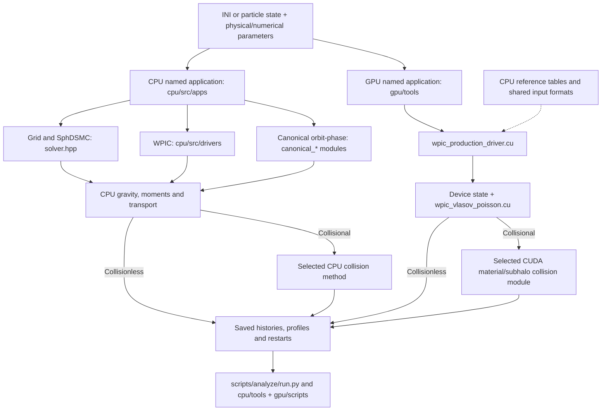

# VENUS 1.0: a kinetic simulation code for self-gravitating systems

[Equations](#governing-equations) · [Numerical implementation](#numerical-implementation-of-the-equations) · [Choose a module](#choose-a-module) · [CPU quick start](#cpu-quick-start) · [GPU quick start](#gpu-quick-start) · [Run other modules](#run-other-modules) · [Code structure](#code-structure-and-dependencies) · [Cluster recipes](docs/CLUSTERS.md) · [Full manual](docs/venus_manual.pdf)

Gravity builds structure across an extraordinary range of scales, from
globular clusters and galaxies to dark matter halos and black holes. These
systems begin with different distributions of matter, yet their evolution
often produces striking regularities. What selects the nearly universal
**density profiles of dark matter halos**? How do the mixing of particle orbits,
gravitational encounters, and dark matter self-interactions redistribute
energy and angular momentum? When does this relaxation establish a
long-lived equilibrium, and when does the central matter continue to collapse?

Continued collapse brings a second fundamental question into view: what is
**the end state of a self-gravitating system**? Which initial distributions form
black holes, and which remain bound or disperse? Near the threshold of black
hole formation, [type I critical collapse](https://arxiv.org/abs/gr-qc/0210101)
approaches an intermediate configuration
with a finite black hole mass scale, while type II critical collapse exhibits
black hole mass scaling towards zero at threshold. The matter distribution
and its velocity anisotropy help determine which behavior a family of initial
conditions can support. Around an existing black hole, the same orbital
dynamics and encounters determine the formation and survival of dark matter
spikes, the steep density enhancements that can develop around a central
black hole. Following the distribution through these processes connects halo
relaxation to the strong gravitational fields surrounding black holes.

VENUS, the **Vlasov--Einstein NUmerical Solver**, is being developed to address
these questions with **first-principles kinetic simulations of self-gravitating
matter**. Its scientific goals encompass galaxies, cold dark matter (CDM) and
self-interacting dark matter (SIDM) halos, globular clusters, nuclear star clusters,
and relativistic collapse to black holes. Fluid models describe matter through
averaged quantities such as density, mean velocity, and pressure. A kinetic
description follows the full distribution of positions and velocities. It
therefore retains orbital structure, differences between radial and tangential
velocity dispersions, mixing of particle streams, and departures from local
thermal equilibrium. **Going beyond fluid models** in this way opens
a new frontier for understanding how gravitational systems relax, develop
steep central density cusps or nearly flat cores, and approach black hole formation.

VENUS combines the following capabilities in one kinetic simulation framework:

- **Self-consistent Newtonian and relativistic gravity:** matter determines
  its own gravitational field, including the geometry of spacetime (the metric)
  in relativity. Vlasov--Poisson follows collective gravity.
  Boltzmann--Poisson also includes encounters. Einstein--Vlasov couples
  collisionless matter to relativistic gravity.
- **Collisionless relaxation and collisional transport:** orbital mixing,
  many small deflections (Fokker--Planck/Landau methods), individual finite
  deflections (Boltzmann collision methods),
  subhalo scattering and capture, and material self-interacting dark matter.
- **Complementary representations of the distribution:** phase space grids,
  weighted particle-in-cell (WPIC), spherical direct simulation Monte Carlo
  (SphDSMC), and a method that stores matter by its bound orbit and position along that orbit
  (canonical orbit phase transport).
- **Static and prescribed expanding Newtonian backgrounds**, together with
  isolated relativistic evolution in Schwarzschild coordinates and ingoing
  Eddington--Finkelstein coordinates. The latter remain regular at a black hole
  horizon, allowing matter to be followed across it.
- **CPU and NVIDIA GPU execution**, including distributed calculations through
  the Message Passing Interface (MPI). Named programs select the
  physical tasks. Saved states allow runs to resume, and analysis tools track
  mass, energy and the evolving distribution.

The current equations use spherical symmetry while retaining distributions of
radial and tangential particle motion. A phase space grid stores the distribution
in position and velocity cells. WPIC represents it through particles carrying
mass weights. SphDSMC follows persistent particles and samples their local
encounters. These representations allow the same physical questions to be
studied through different numerical methods. The relativistic elastic-scattering
library supplies local material collisions and coupling to the two relativistic
coordinate systems. Its individual components have tests. A complete
relativistic collisional application also requires tests of the chosen physical problem.

The scientific questions above define the research program. Each quantitative
application specifies its interaction law, initial and boundary conditions, and
resolution studies. Adaptive-grid development will be distributed separately
when ready.

Co-developers: [Uddipan Banik](https://uddipanbanik.pages.dev/), Frank van den Bosch, and Sachiet Kapur.

[VENUS code on GitHub](https://github.com/uddipanbanik/VENUS) ·
[Archived release on Zenodo](https://doi.org/10.5281/zenodo.24267952)
VENUS uses the [BSD 3-Clause License](LICENSE). Citation information is in
[CITATION.cff](CITATION.cff).

## Choose a module

Choose the gravitational equations, representation of the distribution, and
encounter model for the physical problem. The tables list every primary
solver and its example script. CPU executables are built in `cpu/`. GPU
executables in `build/gpu/` or `build/gpu-mpi/`.

A static background sets cosmological expansion to zero while the
self-consistent field responds to the relaxing matter. Expanding Newtonian
modules use a prescribed cosmological background. Subhalo modules describe
scattering and capture between extended clumps. Material SIDM modules describe scattering between constituent dark matter
particles. The relativistic coordinate choices are Schwarzschild (SC) and
ingoing Eddington--Finkelstein (EF). The equations and coordinate conventions
are given [below](#governing-equations).

### CPU module names and executables

| Physical module | Executable in `cpu/` | Background and runnable example |
|---|---|---|
| Non-relativistic collisionless: Vlasov--Poisson grid | `venus_cpu_vlasov_poisson_eulerian` | Static [`vp_grid_static.sh`](examples/run/vp_grid_static.sh); expanding [`vp_grid_expanding.sh`](examples/run/vp_grid_expanding.sh) |
| Non-relativistic collisionless: static Vlasov--Poisson WPIC | `venus_cpu_vlasov_poisson_wpic_static` | Static; [`vp_wpic_static.sh`](examples/run/vp_wpic_static.sh) |
| Non-relativistic collisionless: expanding Vlasov--Poisson WPIC | `venus_cpu_vlasov_poisson_wpic_expanding` | Expanding; [`vp_wpic_expanding.sh`](examples/run/vp_wpic_expanding.sh) |
| Non-relativistic collisional: subhalo WPIC | `venus_cpu_subhalo_wpic` | Static [`subhalo_static.sh`](examples/run/subhalo_static.sh); expanding [`subhalo_expanding.sh`](examples/run/subhalo_expanding.sh) |
| Non-relativistic collisional: Fokker--Planck Boltzmann--Poisson | `venus_cpu_boltzmann_poisson_fokker_planck` | Static or expanding; [`bp_fokker_planck.sh`](examples/run/bp_fokker_planck.sh) |
| Non-relativistic collisional: Landau Boltzmann--Poisson | `venus_cpu_boltzmann_poisson_landau` | Static or expanding; [`bp_landau.sh`](examples/run/bp_landau.sh) |
| Non-relativistic collisional: exact finite-angle Boltzmann--Poisson | `venus_cpu_boltzmann_poisson_exact` | Static or expanding under task controls; [`bp_exact.sh`](examples/run/bp_exact.sh) |
| Non-relativistic collisional: reversible finite-angle Boltzmann--Poisson | `venus_cpu_boltzmann_poisson_reversible` | Static; [`bp_reversible.sh`](examples/run/bp_reversible.sh) |
| Non-relativistic collisional: sampled reversible Boltzmann--Poisson | `venus_cpu_boltzmann_poisson_reversible_sampled` | Static; [`bp_reversible_sampled.sh`](examples/run/bp_reversible_sampled.sh) |
| Non-relativistic collisional: streamed reversible Boltzmann--Poisson | `venus_cpu_boltzmann_poisson_reversible_streamed` | Static; [`bp_reversible_streamed.sh`](examples/run/bp_reversible_streamed.sh) |
| Non-relativistic collisional: finite-angle operator selector | `venus_cpu_boltzmann_poisson_finite_angle` | Selected task background; [`bp_finite_angle.sh`](examples/run/bp_finite_angle.sh) |
| Non-relativistic collisional: expanding prompt-cusp Boltzmann--Poisson | `venus_cpu_boltzmann_poisson_expanding_prompt_cusp` | Expanding; example checks initial setup; [`bp_expanding_prompt_cusp.sh`](examples/run/bp_expanding_prompt_cusp.sh) |
| Non-relativistic collisional: canonical orbit phase Boltzmann--Poisson | `venus_cpu_boltzmann_poisson_canonical_orbit` | Static bound-orbit example; [`bp_canonical_orbit.sh`](examples/run/bp_canonical_orbit.sh) |
| Non-relativistic collisional: constant SIDM WPIC | `venus_cpu_sidm_wpic_constant` | Static; [`sidm_wpic_constant.sh`](examples/run/sidm_wpic_constant.sh) |
| Non-relativistic collisional: velocity-dependent SIDM WPIC | `venus_cpu_sidm_wpic_velocity_dependent` | Static; power-law or Yukawa--Born law; [`sidm_wpic_powerlaw.sh`](examples/run/sidm_wpic_powerlaw.sh) |
| Non-relativistic collisional: constant SIDM SphDSMC | `venus_cpu_sidm_sphdsmc_constant` | Static; [`sidm_sphdsmc_constant.sh`](examples/run/sidm_sphdsmc_constant.sh) |
| Non-relativistic collisional: velocity-dependent SIDM SphDSMC | `venus_cpu_sidm_sphdsmc_velocity_dependent` | Static; [`sidm_sphdsmc_velocity_dependent.sh`](examples/run/sidm_sphdsmc_velocity_dependent.sh) |
| Relativistic collisionless: Einstein--Vlasov grid | `venus_cpu_einstein_vlasov_eulerian` | Isolated, evolving spacetime; [`ev_grid.sh`](examples/run/ev_grid.sh) |
| Relativistic collisionless: low-compactness Einstein--Vlasov WPIC | `venus_cpu_einstein_vlasov_wpic_low_compactness` | Isolated, evolving spacetime; [`ev_wpic_low.sh`](examples/run/ev_wpic_low.sh) |
| Relativistic collisionless: compact Einstein--Vlasov WPIC | `venus_cpu_einstein_vlasov_wpic_black_hole` | Schwarzschild [`ev_wpic_schwarzschild.sh`](examples/run/ev_wpic_schwarzschild.sh); ingoing EF [`ev_wpic_eddington_finkelstein.sh`](examples/run/ev_wpic_eddington_finkelstein.sh) |

The Fokker--Planck and Landau methods describe accumulated small deflections.
The finite-angle operators resolve individual deflection angles. Reversible
methods preserve collision/reverse-collision symmetry. Sampled and streamed
variants change how the collision integral is evaluated. Canonical orbit phase
transport stores matter along bound orbits. A star-cluster application supplies
its stellar encounter model to the appropriate transport machinery and validates
that physical approximation.

Grid and SphDSMC programs also have `_openmp` builds for CPU threads.
The two distributed CPU grid programs are
`venus_cpu_vlasov_poisson_eulerian_mpi` and
`venus_cpu_einstein_vlasov_eulerian_mpi`. CPU WPIC uses one process and its
shared-memory threads. MPI is the library through which separate processes
exchange data. The [parallelism section](#parallel-execution) explains the split.

### GPU module names and executables

| Physical module | Executable in `build/gpu/` | Background and runnable example |
|---|---|---|
| Non-relativistic collisionless: static Vlasov--Poisson WPIC | `venus_gpu_vlasov_poisson_static` | Static; [`gpu_vp_static.sh`](examples/run/gpu_vp_static.sh) |
| Non-relativistic collisionless: Vlasov--Poisson WPIC | `venus_gpu_vlasov_poisson` | Static or Einstein--de Sitter expansion; [`gpu_vp_expanding.sh`](examples/run/gpu_vp_expanding.sh) |
| Non-relativistic collisional: subhalo Boltzmann--Poisson | `venus_gpu_subhalo_boltzmann_poisson` | Static [`gpu_subhalo_static.sh`](examples/run/gpu_subhalo_static.sh); expanding [`gpu_subhalo_expanding.sh`](examples/run/gpu_subhalo_expanding.sh) |
| Non-relativistic collisional: constant material SIDM | `venus_gpu_sidm_constant` | Static; [`gpu_sidm_constant.sh`](examples/run/gpu_sidm_constant.sh) |
| Non-relativistic collisional: softened power-law material SIDM | `venus_gpu_sidm_power_law` | Static; [`gpu_sidm_power_law.sh`](examples/run/gpu_sidm_power_law.sh) |
| Non-relativistic collisional: Yukawa--Born material SIDM | `venus_gpu_sidm_yukawa_born` | Static; [`gpu_sidm_yukawa_born.sh`](examples/run/gpu_sidm_yukawa_born.sh) |
| Non-relativistic collisional: explicit SIDM law selector | `venus_gpu_sidm_boltzmann_poisson` | Static; [`gpu_sidm_explicit_law.sh`](examples/run/gpu_sidm_explicit_law.sh) |

Einstein--de Sitter is the prescribed matter-dominated expanding background.
The GPU build supplies weighted particles, gravity and the collision methods
listed above. The relativistic, Eulerian-grid, canonical-orbit and SphDSMC
methods use the CPU programs.

The distributed GPU programs, created by an MPI build, are:

- `venus_gpu_vlasov_poisson_mpi` and `venus_gpu_subhalo_boltzmann_poisson_mpi`
  for Einstein--de Sitter expansion.
- `venus_gpu_sidm_constant_mpi`, `venus_gpu_sidm_power_law_mpi`,
  `venus_gpu_sidm_yukawa_born_mpi`, and `venus_gpu_sidm_boltzmann_poisson_mpi`
  for static material SIDM.

### Libraries and physical applications

| Physical component | Actual module or interface | Use |
|---|---|---|
| Relativistic collisional material scattering | `cpu/include/ev/relativistic_boltzmann/`; `eb::advance_sc`, `eb::advance_ef` | C++ library coupled to SC/EF streaming; [equations and scope](docs/relativistic_boltzmann.md) |
| Stellar gravitational relaxation | `boltzmann_poisson.hpp`, `finite_angle_boltzmann.hpp` and the selected encounter model | Supply the physical stellar interaction law and establish application convergence |
| Relativistic subhalo capture or stellar encounters | Dedicated application runners are future work | Select an implemented interaction model for a quantitative calculation |
| Python Einstein--Vlasov reference and readers | `cpu/python/ev_solver/` | Reference calculations and output analysis |

The [source map below](#code-structure-and-dependencies) names the numerical
files behind these programs. The [full module catalogue](notes/SOLVER_MODULES.md)
gives each method, required input format and physical assumptions. Every example also has a named Slurm script under [`examples/slurm/`](examples/slurm/).

## Build, run, and analyze

### Get the code and Python packages

Run the following in a Terminal:

```bash
git clone https://github.com/uddipanbanik/VENUS.git
cd VENUS
python3 -m venv .venv
source .venv/bin/activate
python3 -m pip install -r requirements.txt
```

The commands below start from this repository root. The `.venv` directory
holds the Python packages. Activate it in each new Terminal. Use an existing
checkout/environment if you already have one. Choose a fresh output directory
for every fresh run.

### CPU quick start

This example builds **the Vlasov--Poisson grid module**, evolves an isolated
infalling density shell, and plots the output. It needs a C++17 compiler.

```bash
source scripts/build/macos_toolchain.sh
venus_select_macos_sdk
make -C cpu venus_cpu_vlasov_poisson_eulerian

cpu/venus_cpu_vlasov_poisson_eulerian \
  --config examples/inputs/vp_grid_static.ini \
  --t-end 0.002 --dt-max 0.001 --threads 2 \
  --save-every 1 --phase-every 1 --restart-every 1 \
  --output-dir output/cpu/first_vp

python3 scripts/analyze/run.py output/cpu/first_vp --plot
```

The first two lines select compatible macOS development files (the software
development kit, or SDK). On Linux they leave the compiler settings in place. The `make`
command then compiles the named program from its C++ source. The run command
selects an INI file, a plain-text list of physical and numerical parameters.
Here it constructs a Gaussian density shell centered at radius `3`, of width
`1`, with inward radial-velocity center `-0.1`. Its grid has `12` radial,
`12` radial-velocity and `8` specific-angular momentum points. Specific angular
momentum is angular momentum per unit mass. All quantities use the run's code
units, the mass, length and time scales chosen for the equations.

`--t-end` selects the endpoint, `--dt-max` caps a timestep, and `--threads`
selects CPU workers. The three `--*-every` options request output after each
accepted step. Command-line values override the INI. This deliberately short,
coarse example introduces the interface. Increase resolution and assess the
timestep and boundaries for a scientific calculation.

The solver saves `metadata.json`, `history.csv`, `profiles.csv`, phase space
projections, and binary checkpoints under `output/cpu/first_vp/`.
`history.csv` records integrated quantities versus time. `profiles.csv` Groups
radial rows by time. The analysis command creates `analysis/summary.json`
and profile/phase space figures and movies inside that run directory.

### GPU quick start

This example builds **the static Vlasov--Poisson WPIC module**, generates a
particle initial state, evolves it on one NVIDIA GPU, then plots the profiles.
CUDA is NVIDIA’s system for running calculations on a GPU. CMake prepares
the build instructions, and a host compiler translates the CPU parts of the
program. Load CUDA, CMake 3.18 or newer and a compatible C++17 host compiler. On a
cluster, run the simulation inside a GPU allocation, a reservation made through
the cluster’s job scheduler. The architecture number selects the GPU model
that the compiler should generate instructions for. Select `75` for RTX
2080 Ti, `80` for A100, or `90` for H200 when configuring CUDA.

```bash
cmake -S gpu -B build/gpu -DCMAKE_BUILD_TYPE=Release \
  -DCMAKE_CUDA_ARCHITECTURES=80
cmake --build build/gpu --target venus_gpu_vlasov_poisson_static -j 4

python3 cpu/tools/generate_bound_gaussian_shell_restart.py \
  --output-directory output/gaussian_ic --particles 4096

build/gpu/venus_gpu_vlasov_poisson_static \
  --restart output/gaussian_ic/static_vp/restart_state.bin \
  --universe static \
  --radial-cells 512 --radial-minimum 0.01 --radial-maximum 10000 \
  --maximum-timestep 0.0075 --end-time 0.03 --output-interval 0.015 \
  --history-every 1 --restart-every 1 \
  --output-directory output/gpu/first_vp

python3 scripts/analyze/run.py output/gpu/first_vp --plot --r-max 20
```

The CMake build names the exact executable target. The Python generator runs
on the CPU and creates `static_vp/` and `expanding_vp/` initial-state folders.
Both contain the same physical Gaussian shell, centered at radius `10`, of
width `1`, with support between `7` and `13`. Their stored radial velocities
use the conventions of their respective backgrounds. `--particles` sets the
sampling count. Retain each binary state with its companion mesh/background
files. The explicit radial-mesh arguments match the generated state.

`--maximum-timestep` caps an orbit step. `--output-interval` Sets the physical
spacing between saved profiles. The run writes `history_gpu.csv`,
`profile_*.csv`, `metadata.json`, terminal diagnostics and `restart_state.bin`
with its companion files under `output/gpu/first_vp/`. The analysis command
writes `analysis/summary.json` and `analysis/density_slope.gif`. Density shows
where the mass lies. Its logarithmic slope shows how steeply density changes
with radius. CPU particle programs can use the same generator without a GPU.

## Run other modules

Build the program whose name matches the physical model. The commands below
use the same explicit build, input, run and analysis pattern as the quick starts.
The named scripts in the catalogue provide the complete small example for
all remaining tasks, including initial-data preparation.

### Non-relativistic Vlasov--Poisson: weighted particles and expansion

```bash
make -C cpu venus_cpu_vlasov_poisson_wpic_static \
  venus_cpu_vlasov_poisson_wpic_expanding

cpu/venus_cpu_vlasov_poisson_wpic_static \
  --gamma 1.5 --initial-velocity-factor 1 \
  --radial-cells 16 --radial-minimum 0.1 --radial-maximum 10 \
  --particles-per-radial-cell 128 --maximum-timestep 0.001 \
  --end-time 0.01 --output-interval 0.005 --history-every 1 --restart-every 1 \
  --threads 2 --output-directory output/cpu/vp_particles

cpu/venus_cpu_vlasov_poisson_wpic_expanding \
  --vp-universe expanding --vp-alpha 0.6666666666666666 --vp-time-offset 12 \
  --gamma 1.5 --radial-cells 16 --radial-minimum 0.1 --radial-maximum 10 \
  --particles-per-radial-cell 128 --maximum-timestep 0.001 \
  --end-time 0.01 --output-interval 0.005 --history-every 1 --restart-every 1 \
  --threads 2 --output-directory output/cpu/vp_expanding

python3 scripts/analyze/run.py output/cpu/vp_particles --plot --r-max 10
```

`--gamma` selects the initial power-law cusp slope. `--initial-velocity-factor`
rescales the fresh physical velocities and specific angular momenta. Use it
to prepare colder or warmer initial conditions. The expanding program uses
`H=alpha/(t+time_offset)`. For an expanding **grid** calculation, use
`venus_cpu_vlasov_poisson_eulerian` with
[`vp_grid_expanding.ini`](examples/inputs/vp_grid_expanding.ini).
For **GPU** expansion, build `venus_gpu_vlasov_poisson`, select
`--universe eds`, and import `output/gaussian_ic/expanding_vp/restart_state.bin`
with the same mesh/time controls as the GPU quick start.

### Non-relativistic Boltzmann--Poisson: small-angle transport

```bash
make -C cpu venus_cpu_boltzmann_poisson_fokker_planck \
  venus_cpu_boltzmann_poisson_landau

cpu/venus_cpu_boltzmann_poisson_fokker_planck \
  --config examples/inputs/bp_fokker_planck.ini \
  --bp-cross-section constant --bp-sigma0 0.001 --bp-collision-strength 0.01 \
  --t-end 0.002 --dt-max 0.001 --threads 2 \
  --output-dir output/cpu/bp_fokker_planck

cpu/venus_cpu_boltzmann_poisson_landau \
  --config examples/inputs/bp_landau.ini \
  --bp-cross-section constant --bp-sigma0 0.001 --bp-collision-strength 0.01 \
  --t-end 0.002 --dt-max 0.001 --threads 2 \
  --output-dir output/cpu/bp_landau

python3 scripts/analyze/run.py output/cpu/bp_fokker_planck --plot
```

The INIs select the corresponding encounter operator. `--bp-cross-section`
selects the interaction law, `--bp-sigma0` its normalization, and
`--bp-collision-strength` the rate multiplier. These values belong to the
stated example. A physical SIDM, subhalo or stellar application chooses its
law and normalization in the same code units as the initial distribution.

For exact finite-angle, reversible, sampled, streamed and canonical-orbit
transport, use the separately named programs in the CPU table. Their
examples prepare the required cell averages or orbit atlas, a table of bound
orbits and positions along them. For example:

```bash
make -C cpu venus_cpu_boltzmann_poisson_reversible
bash scripts/build/tools.sh
bash examples/run/bp_reversible.sh --dry-run
bash examples/run/bp_reversible.sh --output output/cpu/bp_reversible
python3 scripts/analyze/run.py output/cpu/bp_reversible --plot
```

`--dry-run` prints the complete `cpu/venus_cpu_boltzmann_poisson_reversible`
command and input path before execution. The [run-options reference](docs/RUN_OPTIONS.md)
lists the operator-specific quadrature, sampling, locality and collision controls.

### Non-relativistic Boltzmann--Poisson: subhalo scattering and capture

```bash
make -C cpu venus_cpu_subhalo_wpic
cpu/venus_cpu_subhalo_wpic \
  --vp-universe static --gamma 1.5 \
  --radial-cells 16 --radial-minimum 0.1 --radial-maximum 10 \
  --particles-per-radial-cell 128 --maximum-timestep 0.001 \
  --subhalo-collision-strength 0.001 --subhalo-collision-interval 0.001 \
  --end-time 0.01 --output-interval 0.005 --history-every 1 --restart-every 1 \
  --threads 2 --output-directory output/cpu/subhalo
python3 scripts/analyze/run.py output/cpu/subhalo --plot --r-max 10
```

The strength enables the subhalo encounter model. The interval caps a collision
batch. Add `--subhalo-adaptive-cell-timestep` for independent collision-cell
clocks on the fixed radial mesh. Material SIDM uses its own modules below.

The corresponding GPU executable is `venus_gpu_subhalo_boltzmann_poisson`:

```bash
cmake --build build/gpu --target venus_gpu_subhalo_boltzmann_poisson -j 4
build/gpu/venus_gpu_subhalo_boltzmann_poisson \
  --restart output/gaussian_ic/static_vp/restart_state.bin --universe static \
  --radial-cells 512 --radial-minimum 0.01 --radial-maximum 10000 \
  --subhalo-collision-strength 0.001 \
  --maximum-timestep 0.0075 --end-time 0.03 --output-interval 0.015 \
  --history-every 1 --restart-every 1 \
  --output-directory output/gpu/subhalo
python3 scripts/analyze/run.py output/gpu/subhalo --plot --r-max 20
```

### Non-relativistic Boltzmann--Poisson: material SIDM

Generate `output/gaussian_ic/` with the Python command in the GPU quick start.
That generator itself requires only the CPU and NumPy. A constant-law CPU WPIC
run then reads the static particle state:

```bash
make -C cpu venus_cpu_sidm_wpic_constant
cpu/venus_cpu_sidm_wpic_constant \
  --pic-restart output/gaussian_ic/static_vp/restart_state.bin \
  --radial-cells 32 --radial-minimum 0.01 --radial-maximum 10000 \
  --radial-velocity-cells 24 --eta-cells 24 \
  --radial-velocity-maximum 6 --angular-momentum-maximum 16 \
  --sidm-cross-section constant --sidm-sigma0 0.001 --collision-strength 0.01 \
  --maximum-timestep 0.001 --end-time 0.002 --threads 2 \
  --output-every 1 --restart-every 1 \
  --phase-space-projection-at-output-only --skip-final-phase-space-projection \
  --output-directory output/cpu/sidm
python3 scripts/analyze/run.py output/cpu/sidm --plot --r-max 20
```

`venus_cpu_sidm_wpic_velocity_dependent` selects `--sidm-cross-section powerlaw`
or `yukawa_born`, with `--sidm-u0`, `--sidm-power` or the `--yukawa-*` parameters.
The SphDSMC alternatives are `venus_cpu_sidm_sphdsmc_constant` and
`venus_cpu_sidm_sphdsmc_velocity_dependent`. They read the corresponding
[`examples/inputs/`](examples/inputs/) INIs through `--config`.

For GPU material SIDM, build a named law and supply its parameters explicitly:

```bash
cmake --build build/gpu --target venus_gpu_sidm_power_law -j 4
build/gpu/venus_gpu_sidm_power_law \
  --restart output/gaussian_ic/static_vp/restart_state.bin --universe static \
  --radial-cells 512 --radial-minimum 0.01 --radial-maximum 10000 \
  --sidm-collision-strength 0.01 --sidm-sigma0 0.001 \
  --sidm-sigma-u0 1 --sidm-sigma-power 4 \
  --maximum-timestep 0.0075 --end-time 0.03 --output-interval 0.015 \
  --history-every 1 --restart-every 1 \
  --output-directory output/gpu/sidm_power_law
python3 scripts/analyze/run.py output/gpu/sidm_power_law --plot --r-max 20
```

`venus_gpu_sidm_constant` uses `--sidm-sigma0` and the same common controls.
`venus_gpu_sidm_yukawa_born` instead uses `--sidm-yukawa-alpha`,
`--sidm-yukawa-mchi` and `--sidm-yukawa-mphi`.
`venus_gpu_sidm_boltzmann_poisson` selects the law through
`--cross-section-model constant|power_law|yukawa_born`.
The softening speed `--sidm-sigma-u0` keeps the power-law cross section finite
at low relative speed. All GPU material SIDM runs use static halos.

### Relativistic Einstein--Vlasov: grid and weighted particles

```bash
make -C cpu venus_cpu_einstein_vlasov_eulerian \
  venus_cpu_einstein_vlasov_wpic_low_compactness \
  venus_cpu_einstein_vlasov_wpic_black_hole
cpu/venus_cpu_einstein_vlasov_eulerian \
  --config examples/inputs/ev_grid.ini --t-end 0.002 --dt-max 0.001 \
  --threads 2 --output-dir output/cpu/ev_grid
cpu/venus_cpu_einstein_vlasov_wpic_low_compactness \
  --low-markers 2000 --low-radial-cells 64 --low-t-end 45 \
  --low-dt-max 0.06 --low-output-steps 20 --threads 2 \
  --output-dir output/cpu/ev_particles
python3 scripts/analyze/run.py output/cpu/ev_particles --plot
```

The compact WPIC program selects `--coordinates schwarzschild` or
`--coordinates eddington_finkelstein`. Compactness measures gravitational field
strength through `2Gm/(rc^2)`. Schwarzschild coordinates cover the exterior.
Ingoing Eddington--Finkelstein coordinates remain regular at a black hole
horizon. The [CPU tutorial](cpu/README.md#7-relativistic-collapse-and-coordinate-comparisons)
walks through the compact examples. The [coordinate reference](docs/RELATIVISTIC_COORDINATES.md)
explains their compatible initial slices, maps and collapse diagnostics.

## Choose initial data and run options

Each task enforces its equation, background and encounter family. Begin with
that task's example and change the parameters that pose your physical problem.
The table below separates the commonly used controls. The
[complete run-options reference](docs/RUN_OPTIONS.md) lists the accepted
option names for every shared interface, their syntax and task restrictions.

### Grid and SphDSMC options

| Choice | Command-line options | Meaning |
|---|---|---|
| Parameter file | `--config FILE` | Select a sectioned INI file |
| Initial distribution | `--initial-data analytic` or `binary_rwl`; `--initial-data-file PATH` | Built-in distribution or a user-supplied grid file |
| Initial profile | `--shell-initial-df`, `--gaussian-density-shell`, `--top-hat-density-shell`, `--double-gaussian-density-shell` | Select the supported analytic density construction |
| Shell parameters | `--R0`, `--dR`, `--amp`, `--beta`, `--w-in`; second-shell `--R0-2`, `--dR-2`, `--amp-2`, `--w-in-2` | Radius, width, normalization, velocity spread and radial-velocity center |
| Resolution | `--Nr`, `--Nw`, `--NL` | Radial, radial-velocity and specific-angular momentum grid sizes |
| Domain | `--r-min`, `--r-max`, `--w-max`, `--L-max` | Represented position/velocity range |
| Boundaries | `--inner-boundary`, `--outer-boundary`, `--momentum-boundary` | Reflecting, origin-parity, delayed-return or supported open/inflow choices |
| Newtonian background | `--vp-universe`, `--vp-alpha`, `--vp-time-offset`, `--vp-poisson-source` | Static/expanding background and total-density/contrast source |
| Physical time | `--t-end`, `--dt-max`, `--cfl` | Endpoint, step ceiling and transport accuracy control |
| Encounter law | `--bp-cross-section`, `--bp-sigma0`, `--bp-u0`, `--bp-n`, `--bp-yukawa-*` | Constant, power-law, softened gravitational or Yukawa--Born law under task controls |
| Encounter integration | `--bp-collision-strength`, `--bp-collision-cfl`, `--bp-collision-max-substeps` | Rate multiplier and collision timestep controls |
| Output | `--output-dir`, `--save-every`, `--phase-every`, `--restart-every`, `--restart-dir` | Destination and step-based save cadence |
| Continue | `--restart-from PATH` | Read a complete compatible grid checkpoint |
| CPU threads | `--threads N` | Workers within one process |

INI keys use underscores, for example `t_end`. Command-line options use hyphens,
for example `--t-end`. Paths inside an INI are relative to that INI's folder.
Command-line paths are relative to the directory from which you run the program.
Select one density-envelope construction in the INI. To change from a Gaussian
to a top-hat density shell, set `gaussian_density_shell=false` and
`top_hat_density_shell=true`. A profile's velocity support and domain must be resolved along with its density.
For example, vary `R0`, `dR` and `w_in` to change the supplied infalling shell,
then assess the corresponding grid and boundary influence.

### CPU particle and GPU particle options

| Choice | CPU VP/subhalo WPIC | CPU material SIDM WPIC | GPU WPIC |
|---|---|---|---|
| Initial state | Built-in `--gamma`; or `--restart PATH` | `--pic-restart PATH` or `--frank-restart PATH` | `--restart PATH` with matching companion files |
| Fresh velocity scale | `--initial-velocity-factor F` | Set through the imported population | Set through the imported population |
| Radial mesh | `--radial-cells`, `--radial-minimum`, `--radial-maximum` | Same three names | Same three names, matching input |
| Endpoint and orbit step | `--end-time`, `--maximum-timestep` | Same two names | Same two names |
| Profile cadence | `--output-interval` | `--output-every` in accepted steps | `--output-interval` |
| History/checkpoint cadence | `--history-every`, `--restart-every` | `--output-every`, `--restart-every` | `--history-every`, `--restart-every` |
| Run directory | `--output-directory` | `--output-directory` | `--output-directory` |
| Collision model | Subhalo program and `--subhalo-collision-strength` | `--sidm-cross-section`, `--collision-strength` | Named task and `--subhalo-collision-strength` or `--sidm-collision-strength` |
| Collision clocks | `--subhalo-collision-interval`, `--subhalo-collision-cfl`, `--subhalo-adaptive-cell-timestep` | `--collision-cfl`, `--collision-adaptive-shell-timestep` where supported | Subhalo controls or `--sidm-collision-cfl`, `--sidm-adaptive-shell-timestep` |
| Saved particles/phase space | Native checkpoint and task diagnostics | Native checkpoint and projection controls | `--phase-space-snapshot-times T0,T1,...` |
| Processing | `--threads N` | `--threads N` | One GPU, or one MPI process per GPU |

The Gaussian particle generator accepts `--output-directory` and `--particles`.
Its shell shape and velocity sampling are the documented fixed example. Other
particle distributions must use the selected module's native input format.
The [initial-data guide](cpu/examples/initial_data/README.md) and
[script catalogue](notes/SCRIPT_REFERENCE.md) list the supplied generators,
including the Frank-model and SphDSMC inputs. The grid route below accepts a
user-defined distribution function directly.

### Continue and analyze

A complete binary restart retains the evolving distribution, fields and any
collision clocks and random state. A density CSV contains selected averages.
For a Newtonian VP particle continuation:

```bash
cpu/venus_cpu_vlasov_poisson_wpic_static \
  --restart output/cpu/vp_particles/restart_state.bin \
  --gamma 1.5 --radial-cells 16 --radial-minimum 0.1 --radial-maximum 10 \
  --particles-per-radial-cell 128 --maximum-timestep 0.001 \
  --end-time 0.02 --output-interval 0.005 --history-every 1 --restart-every 1 \
  --threads 2 --output-directory output/cpu/vp_particles
```

Repeat the original physical/mesh controls. GPU continuation likewise imports
its complete `restart_state.bin` with its companion files and a later
`--end-time`. Material CPU WPIC imports it through `--pic-restart`. Grid
programs use `--restart-from`. Relativistic WPIC uses `--resume` with the
original run controls. Keep the input, metadata, command and checkpoints
with the run.

`python3 scripts/analyze/run.py RUN --plot` summarizes any recognized run and
uses its appropriate renderer. It accepts `--output DIR`, `--r-max R`, and
`--gamma G` for a chosen reference cusp slope. CSV tables are readable through
NumPy, pandas or a spreadsheet. Each file's header names its columns. The
metadata records the physical model and units.

### Use your own initial distribution

Let $`r`$ be physical radius, $`w`$ radial velocity, and $`L`$ specific angular
momentum. The grid solvers accept a nonnegative distribution $`f(r,w,L)`$
evaluated on a user-selected grid. The supplied
[user_distribution.py](cpu/examples/user_distribution.py) defines a compact
inward-moving shell for a static Vlasov–Poisson example. Edit its
array-based `distribution(r,w,L)` function to choose another population.
For Einstein–Vlasov input, $`w`$ is radial momentum per unit rest mass. For an
expanding Newtonian calculation, it is peculiar radial velocity. The chosen
solver and the distribution must use the same variables and units.

From the release root, generate the binary input, run the supplied
[configuration](cpu/examples/modular/vp_custom_shell.ini), and plot its output:

```bash
python3 cpu/tools/ic_generator_legacy.py \
  --function-file cpu/examples/user_distribution.py \
  --output output/cpu/custom_shell/initial.bin \
  --Nr 64 --Nw 64 --NL 32 --r-min 0.1 --r-max 20 \
  --radial-grid log --w-max 2 --L-max 4
make -C cpu venus_cpu_vlasov_poisson_eulerian
cpu/venus_cpu_vlasov_poisson_eulerian \
  --config cpu/examples/modular/vp_custom_shell.ini \
  --t-end 0.02 --dt-max 0.005 --threads 2
python3 cpu/tools/plot_einstein_vlasov_outputs.py \
  --input-dir output/cpu/custom_shell/run \
  --output-dir output/cpu/custom_shell/plots --no-make-gifs
```

The generator writes `EVICRWL1`: a header identifying the format version, the three coordinate
arrays, and `f[Nr,Nw,NL]` stored with angular momentum varying fastest.
The solver reads the grid from that binary and integrates its moments to
obtain the initial density and gravitational field. The INI file selects
static gravity, collisionless relaxation, boundary conditions, integration
controls, and output cadence. Its file paths are resolved relative to the
INI file. Command-line options override individual settings.

The output directory contains `metadata.json`, `profiles.csv`, `history.csv`,
phase space projections, and periodic restarts under `restarts/`. Inspect
the initial density, velocity support, mass budget, and boundaries before
extending a new physical calculation. Choose a fresh output directory for a
separate run. Weighted-particle solvers use their own initialization and
restart formats. Their input routes are listed in the
[module catalogue](notes/SOLVER_MODULES.md) and derived in the manual.

## Parallel execution

| Module | Work divided across workers | Shared work and supported scope |
|---|---|---|
| CPU grid `_openmp` or portable thread build | Supported cell/radial loops use CPU threads | One process owns the complete distribution |
| CPU collisionless grid `_mpi` | MPI divides the angular momentum grid; threads advance local cells | Radial moments are reduced globally; radial fields are replicated; one designated process writes shared output |
| CPU collisional grid, SphDSMC and WPIC | Supported loops use threads | One process owns encounters, clocks and restart state |
| GPU WPIC | Device threads deposit mass, advance orbits and evaluate supported encounters | One GPU per process; host code prepares input and writes output |
| GPU MPI | Processes own particles/collision regions and reduce radial moments | One process per GPU; radial field arrays are replicated; host memory carries MPI transfers |

Build a named CPU MPI module with
`make -C cpu venus_cpu_vlasov_poisson_eulerian_mpi`. A GPU MPI build uses
`cmake -S gpu -B build/gpu-mpi -DVENUS_GPU_ENABLE_MPI=ON -DCMAKE_CUDA_ARCHITECTURES=80`,
then `cmake --build build/gpu-mpi --target venus_gpu_sidm_constant_mpi -j 4`.
The [cluster guide](docs/CLUSTERS.md) supplies exact IAS Typhon, IAS Apollo and
Perimeter Symmetry module environments, resource requests and launch commands.
File output, global reductions, work done by one worker and uneven division of work limit
parallel speedup. Choose ranks/threads for the selected solver and resolution.

## Code structure and dependencies

The tree below shows the source organization. A `.cpp` or `.cu` file under
an application directory selects a named executable. Shared numerical modules
live in the include/source directories. Build products and run data have
separate destinations.

```text
VENUS/
├── Makefile                         common CPU/GPU build targets
├── cpu/
│   ├── Makefile                     exact venus_cpu_* build targets
│   ├── src/apps/
│   │   ├── vlasov_poisson/           eulerian.cpp, static_wpic.cpp, expanding_wpic.cpp
│   │   ├── boltzmann_poisson/        Fokker--Planck, Landau, finite-angle and orbit-phase entry programs
│   │   ├── subhalo/                 subhalo WPIC entry program
│   │   ├── sidm/                    constant/velocity-dependent WPIC and SphDSMC entry programs
│   │   └── einstein_vlasov/          grid, low-compactness and compact WPIC entry programs
│   ├── src/drivers/                 expanding_wpic.cpp, sidm_wpic.cpp, einstein_vlasov_wpic.cpp
│   ├── include/ev/
│   │   ├── solver*.hpp              grid/SphDSMC setup, state and evolution
│   │   ├── vlasov_poisson.hpp       Newtonian field and grid transport
│   │   ├── weighted_vlasov_pic.hpp  Newtonian weighted-particle gravity and orbits
│   │   ├── boltzmann_poisson.hpp    small-angle encounter transport
│   │   ├── *finite_angle*.hpp       direct/reversible finite-angle operators
│   │   ├── *reversible_boltzmann.hpp sampled/streamed collision integration
│   │   ├── canonical_*.hpp          orbit-phase transport and collision events
│   │   ├── spherical_dsmc_*.hpp     persistent-particle scattering and gravity
│   │   ├── weighted_vlasov_pic_*collisions.hpp  material SIDM and subhalo encounters
│   │   ├── weighted_einstein_vlasov_pic_*.hpp  SC and EF particle evolution
│   │   ├── relativistic_boltzmann/  local relativistic elastic collisions and coupling
│   │   └── grids.hpp, moments.hpp, metric.hpp, output.hpp, parallel.hpp, mpi.hpp
│   ├── python/ev_solver/            reference solver and readers
│   ├── tools/                       initial-state generators, analyzers and renderers
│   ├── examples/                    detailed INIs, custom distributions and binary inputs
│   └── tests/                       C++/Python numerical, restart and interface tests
├── gpu/
│   ├── CMakeLists.txt               exact venus_gpu_* build targets
│   ├── tools/venus_gpu_*.cu         VP, subhalo and material-SIDM entry programs
│   ├── include/venus_gpu/           state, gravity, collision, restart and MPI interfaces
│   ├── src/
│   │   ├── wpic_production_driver.cu common task configuration and evolution
│   │   ├── wpic_state.cu            device particle/field storage
│   │   ├── wpic_vlasov_poisson.cu   CUDA gravity and collisionless transport
│   │   ├── wpic_collisions.cu       CUDA material SIDM
│   │   ├── wpic_subhalo_collisions.cu CUDA subhalo scattering/capture
│   │   ├── wpic_mpi.cpp             MPI ownership, reductions and migration
│   │   └── wpic_restart.cpp, wpic_production_output.cpp
│   ├── tests/                       host/device/MPI and CPU-comparison tests
│   └── scripts/                     GPU analysis/renderer entry points
├── examples/
│   ├── inputs/                      small grid/SphDSMC INIs
│   ├── catalogue.json               executable and complete arguments for every example
│   ├── run/                         one named local run script per example
│   └── slurm/                       one named scheduler script per example/parallel variant
├── scripts/
│   ├── build/                       portable and IAS/Symmetry environment/build helpers
│   ├── run_example.py               input preparation and example execution
│   ├── analyze/                     common analysis interface
│   ├── slurm/                       portable/site submission and build jobs
│   └── check/                       numerical, example and file-identity checks
├── docs/                            manual, run options and cluster/reference guides
├── notes/                           editable manual and exhaustive module/script catalogues
├── analysis/, plots/, movies/       reproduction inputs, figures and evolution movies
├── release/                         validation facts and source checksums
├── build/gpu*/, cpu/build/          generated build products
└── output/                          user-created runs, checkpoints and analysis
```

The following dependency diagram separates CPU and GPU evolution. The GPU
implementation uses selected CPU reference formulae, encounter tables and
compatible input formats. Its evolution runs through CUDA routines.



### Numerical module names behind the executables

| Physical/numerical family | Actual CPU numerical modules | Actual GPU numerical modules |
|---|---|---|
| Vlasov--Poisson gravity and transport | [`vlasov_poisson.hpp`](cpu/include/ev/vlasov_poisson.hpp), [`weighted_vlasov_pic.hpp`](cpu/include/ev/weighted_vlasov_pic.hpp), `advection.hpp` | [`vlasov_poisson.hpp`](gpu/include/venus_gpu/vlasov_poisson.hpp), [`wpic_vlasov_poisson.cu`](gpu/src/wpic_vlasov_poisson.cu) |
| Fokker--Planck/Landau Boltzmann--Poisson | [`boltzmann_poisson.hpp`](cpu/include/ev/boltzmann_poisson.hpp) | CPU implementation |
| Finite-angle Boltzmann--Poisson | [`finite_angle_boltzmann.hpp`](cpu/include/ev/finite_angle_boltzmann.hpp), [`reversible_finite_angle_boltzmann.hpp`](cpu/include/ev/reversible_finite_angle_boltzmann.hpp), [`sampled_reversible_boltzmann.hpp`](cpu/include/ev/sampled_reversible_boltzmann.hpp), [`streamed_reversible_boltzmann.hpp`](cpu/include/ev/streamed_reversible_boltzmann.hpp) | CPU implementation |
| Canonical orbit phase Boltzmann--Poisson | [`canonical_orbit_phase_transport.hpp`](cpu/include/ev/canonical_orbit_phase_transport.hpp), [`canonical_boltzmann_poisson_event.hpp`](cpu/include/ev/canonical_boltzmann_poisson_event.hpp), `canonical_particle_ntc_collision.hpp` | CPU implementation |
| Subhalo scattering/capture | [`weighted_vlasov_pic_subhalo_collisions.hpp`](cpu/include/ev/weighted_vlasov_pic_subhalo_collisions.hpp) | [`subhalo_collisions.hpp`](gpu/include/venus_gpu/subhalo_collisions.hpp), [`wpic_subhalo_collisions.cu`](gpu/src/wpic_subhalo_collisions.cu) |
| Material SIDM WPIC | [`weighted_vlasov_pic_collisions.hpp`](cpu/include/ev/weighted_vlasov_pic_collisions.hpp) | [`material_sidm.hpp`](gpu/include/venus_gpu/material_sidm.hpp), [`wpic_collisions.cu`](gpu/src/wpic_collisions.cu) |
| SphDSMC material scattering | [`spherical_dsmc_collision.hpp`](cpu/include/ev/spherical_dsmc_collision.hpp), [`spherical_dsmc_solver.hpp`](cpu/include/ev/spherical_dsmc_solver.hpp) | CPU implementation |
| Einstein--Vlasov grid | [`metric.hpp`](cpu/include/ev/metric.hpp), `moments.hpp`, `advection.hpp`, `solver_evolution.hpp` | CPU implementation |
| Einstein--Vlasov WPIC | [`weighted_einstein_vlasov_pic_schwarzschild.hpp`](cpu/include/ev/weighted_einstein_vlasov_pic_schwarzschild.hpp), [`weighted_einstein_vlasov_pic_eddington_finkelstein.hpp`](cpu/include/ev/weighted_einstein_vlasov_pic_eddington_finkelstein.hpp), [`weighted_einstein_vlasov_static_shell.hpp`](cpu/include/ev/weighted_einstein_vlasov_static_shell.hpp) | CPU implementation |
| Relativistic elastic material collisions | [`relativistic_boltzmann/`](cpu/include/ev/relativistic_boltzmann/) | CPU library |

The [task-source map](notes/SOLVER_MODULES.md#task-main-source-map) links each
individual application source. The [script catalogue](notes/SCRIPT_REFERENCE.md)
lists all generators, analyzers and renderers. Compatibility dispatchers and
benchmarks retain their own names in that catalogue. Primary runs use the
physical task names in the tables above.

## Physical equations and numerical details

The mathematical model and its numerical implementation define the physical
calculation. The sections below give the governing equations, their variables
and assumptions, the coordinate transformations, and the discrete updates used
by the modules named above. The build and analysis examples connect these
equations to executable calculations. Specialized terms are defined where
they enter and in the [glossary](docs/TERMS.md).

## Governing equations

The distribution supplies the density or stress that determines gravity.
The resulting field advances the particle trajectories, and local encounters
redistribute their velocities or combine subhalos. The equations below use
the conventions of the [solver manual](docs/venus_manual.pdf).

### Newtonian transport and gravity

Let $`r`$ be physical radius, $`t`$ physical time, $`a_{\mathrm H}`$ the
cosmological scale factor, and $`H=\dot a_{\mathrm H}/a_{\mathrm H}`$ the
prescribed expansion rate. A dot denotes a derivative with respect to $`t`$.
The density is $`\rho(r,t)`$ and $`G`$ is Newton’s gravitational constant.
The physical velocity is $`\boldsymbol v_{\mathrm{phys}}=H\boldsymbol r+\boldsymbol v`$,
where $`\boldsymbol v`$ is peculiar velocity and $`w`$ its radial component.
Specific angular momentum has magnitude $`L`$. The stored coordinate is
$`\eta=L^2/2`$, and tangential speed is $`L/r`$. The mass distribution
$`f(t,r,w,\eta)`$ is mass per physical position–velocity volume, so

Here $`w`$ is local radial momentum per unit rest mass. Its local radial
speed is $`w/\epsilon`$, with $`\epsilon=\sqrt{1+w^2+2\eta/r^2}`$.
The energy density $`\rho`$, radial pressure $`p_r`$, and radial momentum
density $`j`$ supply the radial constraints and the current relation. Here
$`m(r)`$ is enclosed gravitational mass and subscripts $`r,\tau`$ denote
partial derivatives:

```math
\mathrm dM=8\pi^2 f\,\mathrm dr\,\mathrm dw\,\mathrm d\eta,
\qquad
\rho(r,t)=\frac{2\pi}{r^2}\int f\,\mathrm dw\,\mathrm d\eta.
```

The potential $`\Phi`$ has units of speed squared. Write
$`\Phi_r=\partial_r\Phi`$ and let $`C[f]`$ be the collision operator. The
kinetic equation and its collisionless characteristics are

```math
\partial_t f+(Hr+w)\partial_r f
 +\left(\frac{2\eta}{r^3}-\Phi_r-Hw\right)\partial_w f
 =C[f],
\qquad
\frac{\mathrm dr}{\mathrm dt}=Hr+w,\qquad
\frac{\mathrm dw}{\mathrm dt}=\frac{2\eta}{r^3}-\Phi_r-Hw,
\qquad \frac{\mathrm d\eta}{\mathrm dt}=0.
```

This is the Boltzmann equation, with $`C[f]`$ the collision operator. Setting
$`C=0`$ gives the Vlasov equation, and $`H=0`$ gives a static background.
With Newton's constant $`G`$ and any
specified central mass $`M_{\mathrm c}`$, let $`\rho_{\mathrm{src}}`$ denote the
**source density** entering Poisson’s equation and $`M_{\mathrm{src}}(r)`$ its
enclosed source mass, including $`M_{\mathrm c}`$. Poisson’s radial constraint gives

```math
\frac{1}{r^2}\partial_r(r^2\Phi_r)=4\pi G\rho_{\mathrm{src}},
\qquad
M_{\mathrm{src}}(r)=M_{\mathrm c}
 +4\pi\int_0^r\rho_{\mathrm{src}}(r')r'^2\,\mathrm dr',
\qquad \Phi_r=\frac{GM_{\mathrm{src}}(r)}{r^2}.
```

Thus the current distribution determines density, enclosed source mass, and
radial gravitational acceleration $`-\Phi_r`$, in that order. An expanding
total-density model uses $`\rho_{\mathrm{src}}=\rho-\bar\rho`$, where
$`\bar\rho`$ is the homogeneous background density. An already
background-subtracted distribution supplies its source directly. An isolated
static halo uses its full density. The field solve includes unresolved inner
mass. See the [Poisson solve and force gather](cpu/include/ev/vlasov_poisson.hpp#L361)
and [Newtonian characteristic update](cpu/include/ev/weighted_vlasov_pic.hpp#L1785).

### Elastic scattering and capture

At a fixed position, let $`\boldsymbol v`$ denote velocity,
$`f_N(\boldsymbol v)`$ the number distribution and $`C_N[f_N]`$ its collision
operator. Let
$`u=|\boldsymbol v_1-\boldsymbol v_2|`$ be relative speed and
$`\mathrm d\Sigma/\mathrm d\Omega`$ the differential cross section, with
dimensions of area per solid angle. Here $`\mathrm d\Omega`$ is the scattering solid-angle element. The common
Hubble velocity cancels from $`u`$. For identical particles the Boltzmann gain and loss terms are

```math
C_N[f_N]\,(\boldsymbol v_1)=
\int \mathrm d^3\boldsymbol v_2\,\mathrm d\Omega\,
u\frac{\mathrm d\Sigma}{\mathrm d\Omega}
\left[f_N(\boldsymbol v'_1)f_N(\boldsymbol v'_2)
      -f_N(\boldsymbol v_1)f_N(\boldsymbol v_2)\right].
```

Primes denote outgoing velocities. The inverse elastic encounter supplies
the gain term. For physical particle mass $`m_\chi`$, the mass distribution
is $`f=m_\chi f_N`$ and its operator uses
$`(\mathrm d\Sigma/\mathrm d\Omega)/m_\chi`$.
An equal-mass SIDM marker of sampling mass $`m_p`$ uses pair area
$`\Sigma_{ij}/m_p=\Sigma/m_\chi`$. Each accepted pair removes its incoming
velocities and installs outgoing velocities. For masses $`m_1,m_2`$,
center-of-mass velocity $`\boldsymbol V=(m_1\boldsymbol v_1+m_2\boldsymbol v_2)/(m_1+m_2)`$,
and outgoing relative direction $`\widehat{\boldsymbol n}'`$, the elastic map is

```math
\boldsymbol v'_1=\boldsymbol V+\frac{m_2}{m_1+m_2}u\widehat{\boldsymbol n}',
\qquad
\boldsymbol v'_2=\boldsymbol V-\frac{m_1}{m_1+m_2}u\widehat{\boldsymbol n}'.
```

SIDM uses the prescribed material cross section. Subhalo scattering
and capture use the calibrated Plummer pair areas. The isotropic runtime
elastic map has $`\mathrm d\Sigma_{\mathrm{sc}}/\mathrm d\Omega=\Sigma_{\mathrm{sc}}/(4\pi)`$.
For whole-object state $`z=(\boldsymbol v,m,E_{\mathrm{int}})`$, with internal
energy $`E_{\mathrm{int}}`$ and
$`\mathrm dz=\mathrm d^3\boldsymbol v\,\mathrm dm\,\mathrm dE_{\mathrm{int}}`$,
write the number distribution as $`f_N(z)`$. Let $`z_{\mathrm{rem}}`$ be
the remnant state, $`\Sigma_{\mathrm{cap}}`$ the capture cross section and
$`\delta`$ the Dirac distribution on that state space. Capture contributes

```math
\begin{aligned}
&C_{\mathrm{cap},N}(z)=\frac12\int\mathrm dz_1\,\mathrm dz_2\,
f_N(z_1)f_N(z_2)u\Sigma_{\mathrm{cap}}
\times\left[\delta(z-z_{\mathrm{rem}})
 -\delta(z-z_1)-\delta(z-z_2)\right],\\
&m_{\mathrm{rem}}=m_1+m_2,\qquad
\boldsymbol v_{\mathrm{rem}}=\boldsymbol V,\qquad E_{\mathrm{int,rem}}=E_{\mathrm{int},1}+E_{\mathrm{int},2}
 +\frac{m_1m_2u^2}{2(m_1+m_2)}.
\end{aligned}
```

The Dirac distributions act on the full state: two incoming objects are
removed and one remnant is added. The factor one-half counts unordered
pairs once. The elastic operator extends over partner mass and internal
energy with both quantities preserved in each elastic event. The total
operator is $`C_N=C_{\mathrm{sc},N}+C_{\mathrm{cap},N}`$.
Integrating $`m f_N`$ over mass and internal energy supplies the gravitational
mass distribution. See the [SIDM sampler](cpu/include/ev/weighted_vlasov_pic_collisions.hpp#L987)
and [subhalo pair laws](cpu/include/ev/weighted_vlasov_pic_subhalo_collisions.hpp#L325),
[scattering and remnant update](cpu/include/ev/weighted_vlasov_pic_subhalo_collisions.hpp#L1664).

### Einstein–Vlasov gravity

The relativistic modules set Newton’s constant $`G`$ and the speed of light
$`c`$ to unity, $`G=c=1`$, and use unit particle rest mass and metric
signature $`(-,+,+,+)`$. Here $`f`$ is the particle-number distribution.
With spacetime indices $`\alpha,\beta,\gamma`$, four-momentum $`p^\alpha`$, metric
$`g_{\alpha\beta}`$, and particle proper time $`\tau_{\mathrm p}`$, repeated spacetime
indices are summed. The coordinates are $`x^\alpha`$, the Einstein tensor is
$`G_{\alpha\beta}`$, the matter stress tensor is $`T_{\alpha\beta}`$, and
$`\Gamma^\alpha_{\beta\gamma}`$ are the metric connection coefficients.
The governing system is

```math
G_{\alpha\beta}=8\pi T_{\alpha\beta},\qquad
g_{\alpha\beta}p^\alpha p^\beta=-1,
\qquad
\frac{\mathrm dx^\alpha}{\mathrm d\tau_{\mathrm p}}=p^\alpha,\qquad
\frac{\mathrm dp^\alpha}{\mathrm d\tau_{\mathrm p}}=-\Gamma^\alpha_{\beta\gamma}p^\beta p^\gamma,
\qquad
\frac{\mathrm df}{\mathrm d\tau_{\mathrm p}}=0,\qquad
\frac{\mathrm d\eta}{\mathrm d\tau_{\mathrm p}}=0.
```

The geodesic characteristic equations evolve
position and momentum while carrying $`f`$ unchanged. Radial Einstein constraints reconstruct its metric
at each coupled particle stage.

In **Schwarzschild coordinates**, $`\tau`$ is coordinate time, also written
$`\tilde t`$ in the coordinate-map section, and $`r`$ is
areal radius. With $`\mathrm d\Omega^2`$ the unit-sphere metric, the functions
$`\mu,\lambda`$ determine the lapse and proper radial distance:

```math
\mathrm ds^2=-e^{2\mu}\mathrm d\tau^2+e^{2\lambda}\mathrm dr^2
 +r^2\mathrm d\Omega^2.
```

Here $`v`$ is advanced time, $`r`$ is areal radius, and $`\mathrm d\Omega^2`$
is the unit-sphere metric. Positive canonical radial momentum $`P`$ is
conjugate to $`r`$.
The dimensionless field $`a=1-2m/r`$ is the compactness gap, and positive
$`b`$ sets the advanced-time normalization relative to the outer vacuum.
Define $`\chi=1+2\eta/r^2`$. The covariant stress component $`T_{rr}`$ and
source combination $`S`$ determine the radial constraints:

```math
(\rho,p_r,j)=\frac{2\pi}{r^2}\int f
 \left(\epsilon,\frac{w^2}{\epsilon},w\right)
 \mathrm dw\,\mathrm d\eta,
\qquad
m_r=4\pi r^2\rho,\qquad e^{-2\lambda}=1-\frac{2m}{r},
\qquad
\mu_r=\frac{m/r^2+4\pi r p_r}{1-2m/r},\qquad
\lambda_\tau=-4\pi r e^{\lambda+\mu}j.
```

The radial solve reconstructs $`m,\lambda,\mu`$, and the
$`\lambda_\tau`$ relation supplies the current contribution to the momentum
rate. These fields advance the collisionless characteristics:

```math
\frac{\mathrm dr}{\mathrm d\tau}=e^{\mu-\lambda}\frac{w}{\epsilon},
\qquad
\frac{\mathrm dw}{\mathrm d\tau}=-\lambda_\tau w
 -e^{\mu-\lambda}\mu_r\epsilon
 +e^{\mu-\lambda}\frac{2\eta}{r^3\epsilon}.
```

The regular-center solve starts from $`m(0)=0`$ and matches the lapse to
the outer vacuum. See the [Schwarzschild metric reconstruction](cpu/include/ev/weighted_einstein_vlasov_pic_schwarzschild.hpp#L716)
and [characteristics](cpu/include/ev/weighted_einstein_vlasov_pic_schwarzschild.hpp#L1022).

In **ingoing EF coordinates**, the metric is

```math
ds^2=-ab^2\,dv^2+2b\,dv\,dr+r^2d\Omega^2
```

```math
T_{rr}=\frac{2\pi}{r^2}\int P f\,\mathrm d\eta\,\mathrm dP,
\qquad
S=\frac{2\pi}{r^2}\int\frac{\chi}{P}f\,\mathrm d\eta\,\mathrm dP,
\qquad
\partial_r\ln b=4\pi rT_{rr},\qquad
\frac1b\partial_r(mb)=2\pi r^2(T_{rr}+S),
\qquad a=1-\frac{2m}{r}.
```

Isolated evolution fixes the outer gravitational mass and $`b=1`$ in the
surrounding vacuum. The reconstructed center supplies a constraint residual.
The Hamiltonian $`\mathcal H=-p_v=b(aP+\chi/P)/2`$, where $`p_v`$ is
conjugate to $`v`$, gives

```math
\frac{\mathrm dr}{\mathrm dv}=\frac b2\left(a-\frac\chi{P^2}\right),
\qquad
\frac{\mathrm dP}{\mathrm dv}=-\frac P2(ab_r+ba_r)
 -\frac{b_r\chi}{2P}+\frac{2b\eta}{Pr^3}.
```

The code evolves $`\ln P`$ to retain $`P>0`$ through its orbit stages.
See the [EF stress deposition and constraints](cpu/include/ev/weighted_einstein_vlasov_pic_eddington_finkelstein.hpp#L655)
and [Hamiltonian rates](cpu/include/ev/weighted_einstein_vlasov_pic_eddington_finkelstein.hpp#L1226).
The [interior-evolution guide](cpu/docs/ef_interior_evolution.md) explains
trapping, observer density, and the domain conditions for horizon crossing.

### Relativistic material collisions

The [relativistic collision library](docs/relativistic_boltzmann.md) supplies local covariant elastic scattering in Schwarzschild (SC) and ingoing Eddington–Finkelstein (EF) coordinates. A material particle has rest mass $`m_\chi`$. A packet carries represented rest mass $`W_i`$ and represents $`q_i=W_i/m_\chi`$ material particles. Its numerical weight tells the collision sampler how many physical particles share the stored momentum. For specific four-momentum $`p^\alpha`$ with $`p\cdot p=-1`$, the rest-mass distribution $`f`$ has collision operator $`\mathcal C[f]`$.

Here $`\partial_\alpha=\partial/\partial x^\alpha`$ for spacetime coordinates $`x^\alpha`$, $`i`$ labels three independent momentum components, and $`\Gamma^i{}_{\alpha\beta}`$ are the metric connection coefficients. Write $`f_i=f(x,p_i)`$ for the distribution at the labeled momentum and
$`p^{\hat0}`$ for positive local specific energy. The local invariant measure is $`\mathrm d\Pi=\mathrm d^3p/p^{\hat0}`$, and the specific pair flux is $`\mathcal F_{12}=\sqrt{(p_1\cdot p_2)^2-1}`$. Labels 1/2 and 3/4 denote incoming and outgoing momenta. The material differential cross section is measured in the pair centre-of-momentum frame. Physical momenta are $`k=m_\chi p`$ and the number distribution is $`f_N=f/m_\chi^4`$. The spherical coupled sampler uses constant isotropic area $`\mathrm d\Sigma/\mathrm d\Omega=\Sigma/(4\pi)`$. A separate local interface evaluates supplied reciprocal scalar amplitudes.
The relativistic Boltzmann equation is

```math
\begin{aligned}
&p^\alpha\partial_\alpha f-\Gamma^i{}_{\alpha\beta}p^\alpha p^\beta\partial_{p^i}f=\mathcal C[f],\\
&\mathcal C[f_1]=\frac{1}{m_\chi}\int\mathrm d\Pi_2\,\mathcal F_{12}\int\mathrm d\Omega\,\frac{\mathrm d\Sigma}{\mathrm d\Omega}(f_3f_4-f_1f_2).
\end{aligned}
```

SC uses proper cell volume $`V`$, lapse $`e^\mu`$, and local specific energy $`\epsilon=\sqrt{1+w^2+2\eta/r^2}`$. EF uses coordinate shell volume $`V_0`$, metric coefficient $`b`$, and positive specific canonical momentum $`P=p_r`$. Here $`w`$ is SC local radial momentum, $`r`$ is areal radius, and $`\eta=L^2/2`$ for specific angular momentum $`L`$. The packet hazards $`\Gamma_{ij}^{\rm SC}`$ and $`\Gamma_{ij}^{\rm EF}`$ per SC coordinate time $`\tau`$ or advanced EF time $`v`$ are

```math
\begin{aligned}
&\Gamma_{ij}^{\rm SC}=\max(W_i,W_j)\frac{\Sigma}{m_\chi}\frac{e^\mu\mathcal F_{ij}}{V\epsilon_i\epsilon_j},\\
&\Gamma_{ij}^{\rm EF}=\max(W_i,W_j)\frac{\Sigma}{m_\chi}\frac{b\mathcal F_{ij}}{V_0P_iP_j}.
\end{aligned}
```

The EF rate counts particle flux through a null surface. `eb::advance_sc` and `eb::advance_ef` first stream the particles self-consistently, assign their current radii to cells, and use the returned `accepted_dt` for the frozen collision exposure. Each cell preserves its random state, residual optical depth, and number-weight bound. The sampler proposes two distinct packets uniformly, then accepts the pair with probability equal to its rate divided by the proposal-rate bound. An accepted event scatters equal portions of the two packets, each carrying the smaller weight. The larger packet retains its remaining weight at its incoming momentum. This realizes the physical pair rate while conserving the represented rest mass and four-momentum. The outgoing momenta are projected to SC or positive EF variables. After all cell batches, the routines reconstruct stress and the Einstein constraints. A zero area returns the direct EV update.

The [guide](docs/relativistic_boltzmann.md) gives the proposal/acceptance equations, exact draw order, conservative split, projection, field feedback, restart ownership, and source links. The [manual chapter](docs/venus_manual.pdf#nameddest=sec:relativistic-material-collisions) derives the slice measures and governing/discrete equations beside literal implementation excerpts. Finite component checks establish local conservation, slice-dependent rates, model-bound cell restart, the collisionless limit, and small source-feedback steps. Homogeneous finite radial cells require explicit opt-in and report separated exchanges. Compact-halo collapse requires equilibrium-preservation, continuous-chronology, spatial-locality, and convergence studies.

## Einstein--Vlasov coordinate modules

The coordinate-map notation uses Schwarzschild time $`\tilde t=\tau`$,
advanced EF time $`v`$, and areal radius $`r`$. The functions $`\mu,\lambda`$
are the SC metric coefficients, while $`a,b`$ are the EF metric coefficients
defined above. Tensor indices $`a,b`$ in $`g^{ab}`$ run over the time and
radial coordinates. There they are indices rather than metric coefficients.
The exterior Schwarzschild vacuum mass is $`M`$, and $`r_\ast`$ denotes its
tortoise radius. The map derivatives are $`A=\partial_{\tilde t}v`$ and
$`F=1/A`$. The diagnostic $`\tau_{\mathrm{inverse}}`$ is SC time recovered by
the inverse map. For the marker measure, $`W_p`$ is invariant rest weight,
$`\psi`$ is an arbitrary test function and $`\widehat f[\psi]`$ is its
weighted sum over markers. The variable $`u=\log P`$ used by the EF integrator
is distinct from the relative speed $`u`$ in the collision sections.

The compatibility header
[`cpu/include/ev/weighted_einstein_vlasov_pic.hpp`](cpu/include/ev/weighted_einstein_vlasov_pic.hpp)
exposes two distinct implementations:

- [`weighted_einstein_vlasov_pic_schwarzschild.hpp`](cpu/include/ev/weighted_einstein_vlasov_pic_schwarzschild.hpp)
  evolves the polar--areal variables and stops before
  $`2m/r=1`$, where that chart becomes singular.
- [`weighted_einstein_vlasov_pic_eddington_finkelstein.hpp`](cpu/include/ev/weighted_einstein_vlasov_pic_eddington_finkelstein.hpp)
  evolves the canonical future-directed null-slice momentum $`P=p_r>0`$,
  solves the neutral advanced-null constraints, detects $`a=1-2m/r=0`$,
  and evolves matter through the apparent horizon.

The bound equilibrium generator is separate again:
[`weighted_einstein_vlasov_static_shell.hpp`](cpu/include/ev/weighted_einstein_vlasov_static_shell.hpp)
solves the normalized static continuum problem and emits invariant-weight
adjacent $`(+w,-w)`$ marker pairs. Those weights already include $`e^\lambda`$
and must not be canonicalized a second time.

Select the implementation with `--coordinates schwarzschild` or
`--coordinates eddington_finkelstein`. A raw physical-IC file is deliberately
**not** accepted as fresh EF data: a polar--areal $`\tilde t=\mathrm{constant}`$ slice is
spacelike, whereas an ingoing $`v=\mathrm{constant}`$ slice is null. VENUS therefore
first evolves a deterministic Schwarzschild donor history, solves the ingoing
eikonal equation, and intersects that null hypersurface with every marker
worldline. Here the eikonal equation is simply the equation requiring the
surface to be made of light rays. The resulting null-slice file records both
its provenance and SHA-256 content hashes. That checked file, rather than the
raw spacelike IC, initializes the EF run.

In polar--areal coordinates,

```math
ds^2=-e^{2\mu}\,d\tilde t^2+e^{2\lambda}\,dr^2+r^2d\Omega^2.
```

The future ingoing coordinate satisfies
$`g^{ab}\partial_a v\,\partial_b v=0`$, with the advanced root
$`\partial_r v=e^{\lambda-\mu}\partial_{\tilde t}v`$. Writing
$`A=\partial_{\tilde t}v>0`$ gives
$`dv=A\bigl[d\tilde t+e^{\lambda-\mu}dr\bigr]`$,
$`a=e^{-2\lambda}`$, and $`b=e^{\lambda+\mu}/A`$.
The inverse one-form is
$`d\tilde t=F\bigl[dv-dr/(ab)\bigr]`$, where $`F=1/A`$ and
$`\partial_r F=-\partial_v\bigl[F/(ab)\bigr]`$. In a static Schwarzschild exterior with
the clocks normalized at infinity, $`A=F=1`$ and
$`v=\tilde t+r_{\ast}`$, $`\tilde t=v-r_{\ast}`$, with
$`r_{\ast}=r+2M\log\left|r/(2M)-1\right|`$.

The forward equation is the full ingoing eikonal equation:

```math
-e^{-2\mu}(\partial_{\tilde t}v)^2+e^{-2\lambda}(\partial_r v)^2=0.
```

The displayed positive root chooses future-directed, inward-moving null
surfaces. In a dynamical spacetime, neither direction of the map is a static
tortoise-radius substitution: the forward or inverse eikonal equation must be
solved through the relevant spacetime history.

The same-event checker evolves the logarithms of the map Jacobians, not the
Jacobians directly. Along a forward null ray,
$`\frac{d\log A}{dr}=-\partial_{\tilde t}\bigl[e^{\lambda-\mu}\bigr]`$. Along an inverse ray with
$`q=1/(ab)`$, $`\frac{d\log F}{dr}=\partial_v q`$. Thus $`A=\exp(\log A)>0`$ and
$`F=\exp(\log F)>0`$ by construction. This is the exact tangent equation. It
prevents a stiff explicit step from inventing a negative Jacobian. It does
not excuse insufficient resolution. The strict history check compares
otherwise identical $`n`$- and $`2n`$-substep traces using the raw changes in
coordinate time and in $`\log A`$ or $`\log F`$, each at the unchanged $`2\times10^{-5}`$
ceiling. It does not divide a log-Jacobian mismatch by $`|\log A|`$ or assume a
Richardson factor before fourth-order behavior has been demonstrated.
For a coordinate comparison, $`n`$ is one explicit positive integer set by
`VENUS_EIKONAL_SUBSTEPS`. The same value is authenticated in all four
resolution/realization diagnostics, the convergence evidence, and the final
certificate. Each diagnostic still computes both the $`n`$- and $`2n`$-substep
solutions and uses the refined $`2n`$ result. A missing or inconsistent value
stops the calculation. The production
Slurm scripts and Python tools are pinned to the staged `VENUS_SOURCE_ROOT`:
their submission-time SHA-256 identities are checked before and after every
dependent job and carried into the evidence. Inherited tool or Slurm-script
overrides are rejected.
The checker uses the production spatial reconstruction. On the Schwarzschild side it linearly joins
each face and center value of $`\lambda`$, uses the production slope-limited
cubic through the corresponding face/center values and radial derivatives of
$`\mu`$, and only then forms $`e^{\lambda-\mu}`$. On the EF side it linearly joins
face/center values of $`a`$ and $`b`$. The profile CSVs save these face data, and
version 2 of the authenticated `VENUSSCHIST1` donor history saves the SC face
data for negative $`\tilde t`$ as well. Parity certification requires the face and center values used by the
spatial interpolant, together with timestep refinement of the characteristic
integration. Any nonfinite Jacobian or inverse composition fails closed. The
separate composition gate uses
$`\frac{|\tau_{\mathrm{inverse}}-\tau|}{\max(1,|\tau|,|\tau_{\mathrm{inverse}}|)}`$ and
$`\left|\mathrm{expm1}(\log A+\log F)\right|`$, both at the default $`5\times10^{-4}`$ ceiling. This
normalization is not applied to the raw $`n`$-versus-$`2n`$ eikonal changes.

At a common event, the radial covector (the momentum component conjugate to
the radius) maps to

```math
P=p_r^{\mathrm{EF}}=e^\lambda(\epsilon+w)>0,
```

while $`\eta`$ and each marker's
invariant rest weight are unchanged. The EF pusher evolves $`u=\log P`$, so no
finite Runge--Kutta stage can change the required sign of $`P`$. Positive $`P`$
means future directed, not necessarily inward moving: the sign of
$`\frac{dr}{dv}=\frac b2\left[a-\frac{1+2\eta/r^2}{P^2}\right]`$ distinguishes infall, a turning point,
and outward motion. A distribution function is a scalar, meaning that its
value is unchanged at the same mapped event and momentum, with phase space
measure relation $`dP/P=dw/\epsilon`$. A finite WPIC state represents
the empirical measure

```math
\widehat f[\psi]=\sum_p W_p\,\psi(r_p,\mathrm{momentum}_p,\eta_p),
```

not a
pointwise smooth function. The coordinate certificate therefore authenticates
unique IDs/source IDs, invariant weights and $`\eta`$, and mapped positions and
momenta, while separately checking the metric pullback (the explicit
Jacobian change of tensor components) and every covariant
stress-tensor component on the same events. A comparison is inconclusive if
the forward or inverse eikonal, event coverage, phase space Jacobian, empirical
measure, tensor pullback, or resolution/PIC convergence evidence is absent.
At each sampled SC time, the candidate common domain is the one unbroken
radial interval attached to the common outer worldtube. Only a genuine stored-
history boundary or the $`a>10^{-3}`$ chart cutoff may end it. A failed forward
or inverse solve, failed composition, or failed metric identity remains an
unexplained hole inside the claimed interval and fails the certificate. It
cannot be used to shrink the domain until the remaining points look good. The
certifier chooses the longest contiguous block of radially adequate time
slices. Its strict defaults require at least 95% radial coverage on every
selected slice, 95% mapped-event coverage, 95% complete-time-slice coverage,
at least 64 mapped events, at least three complete times, and no holes or
interior re-entry. Field and tensor norms are rebuilt using only this declared
domain. In-domain maxima decide the gate, while separate all-attempted maxima
and exclusion counters preserve every failure outside it. The common domain
never extends past the SC chart. Later post-horizon EF events have no
Schwarzschild-chart counterpart. The required
marker table proves the sampled distribution on the imported initial null
slice. Later mapped metric and every stress/moment component are checked, but
the current writer does not emit the optional later marker-trajectory table.
Accordingly a certificate may not claim later marker-by-marker or pointwise
distribution equality unless its
`later_trajectory_evidence_present` field is true.

The conserved mass attached to the extracted null slice is
$`M_{\mathrm{null}}`$. The donor duration is $`T_{\mathrm{donor}}`$, and
$`\widehat v=v+T_{\mathrm{donor}}`$ labels runtime advanced time relative to
the imported initial slice. The null mapper may use a vacuum worldtube $`R_{\mathrm B}`$ strictly inside the EF
evolution boundary $`R_{\mathrm E}`$. $`R_{\mathrm B}`$ must be an exact mesh face with four-cell
matter/crossing clearance. The eikonal is solved only through $`R_{\mathrm B}`$. On the
initial null slice, the verified vacuum interval $`R_{\mathrm B}<r\le R_{\mathrm E}`$ is continued
exactly with $`m=M_{\mathrm{null}}`$, $`a=1-2M_{\mathrm{null}}/r`$, $`A=F=b=1`$, zero stress, and the
Schwarzschild tortoise difference. This analytic continuation is initial-data
construction only—the EF solver subsequently evolves the complete $`R_{\mathrm E}`$
domain. Both radii, the extension index, map/full-grid fingerprints, vacuum
residuals, and artifact hashes are authenticated on import and resume.
Here “worldtube” means the fixed-radius surface $`r=R_{\mathrm B}`$ followed through
time. It is the boundary where the SC and EF clocks are normalized.

If the extracted surface has the worldtube label $`v=-T_{\mathrm{donor}}`$, runtime output
uses only the shifted origin $`\widehat v=v+T_{\mathrm{donor}}`$, so its imported initial
surface is $`\widehat v=0`$. This shift changes no tensor or momentum component.

Mapped-run summaries keep three masses deliberately separate. The
Schwarzschild $`\tau=0`$ normalization is `fixed_family_adm_mass` and defines the
chosen fixed-ADM angular momentum family. The evolved donor value on the
extracted null slice is `null_slice_conserved_adm_mass`. It is not reset to the
target because its difference measures numerical donor conservation. Finally,
`initial_deposited_adm_mass` is independently reconstructed from the EF
markers on $`\widehat v=0`$. The exact vacuum extension is anchored to the null-slice
mass, not either of the other two. VENUS reports both mismatch channels and
the cluster preflight authenticates them, every map artifact, the vacuum
worldtube, unique crossings, and both component RK4 step-doubling eikonal
errors before dependent jobs can run.

A “realization” is one deterministic shift of the quiet marker sampler, not a
different physical shell. “Convergence” means joint refinement of radial
spacing, timestep, and marker count, with the coordinate errors decreasing
until they are no larger than the difference between realizations. The
minimum certificate therefore needs two resolutions and two realizations.
Its saved cadence must satisfy
$`\frac{\max(\mathtt{saved\_time\_gap})}{\min(\mathtt{radial\_spacing})}\le0.75`$ in both coordinates. For
the documented $`R_{\mathrm E}=24`$, $`N_r=2048`$, `dt_max=0.004` grid this permits
`output_steps <= 2`. Strict parity saves every step. The threshold scout's
`output_steps=50` is a science cadence and cannot issue a new coordinate
certificate.

Let $`M_0`$ be the invariant rest mass of the normalized initial family,
$`M_{\mathrm{ADM}}`$ its Arnowitt--Deser--Misner (ADM) gravitational mass, and
$`M_{\mathrm{family}}`$ the fixed target ADM mass used to normalize threshold
times. Let $`K`$ be Newtonian kinetic energy and $`W`$ the Newtonian force
virial, $`W=-\int\rho r\Phi_r\,\mathrm d^3x`$. These differ from marker
rest weights $`W_p`$. The same normalized Schwarzschild $`\tau=0`$ family also defines
`fixed_family_rest_weight` $`=M_0`$ and the coordinate-independent global binding
diagnostic `fixed_family_binding_fraction` $`=(M_0-M_{\mathrm{ADM}})/M_0`$. SC and mapped EF
summaries, including resumed runs, report the identical family value from an
immutable diagnostic sidecar. It is never recomputed from the later null
slice. A halo label requires a present, internally consistent positive binding
fraction. This is necessary global binding evidence, not proof of equilibrium.
The separately reported marker statistic
$`E_{\mathrm{proxy}}=e^\mu\sqrt{1+w^2+2\eta/r^2}`$ is evaluated in the instantaneously
frozen Schwarzschild $`\tau=0`$ metric. Its minimum, maximum, rest-weighted mean,
and rest-weight fraction with $`E_{\mathrm{proxy}}\ge1`$ are diagnostic only: a dynamical
spacetime has no corresponding conserved particle energy, so the proxy never
acts as a halo gate. Likewise, the reported $`2K/|W|`$ is explicitly a
Newtonian virial proxy rather than a relativistic virial identity.
For the balance diagnostic, $`p_{t,\mathrm{sum}}=p_\theta+p_\phi`$ is the
sum of the tangential pressures and $`R_J`$ is the radial Jeans residual.
At every saved output VENUS evaluates the general-relativistic anisotropic
static-balance residual

```math
R_J=\frac{dp_r}{dr}+(\rho+p_r)\frac{d\mu}{dr}-\frac{p_{t,\mathrm{sum}}-2p_r}{r}
```

and records a
shell-volume-weighted relative L1 norm. For EF data the required polar-areal
moments are pulled back only where $`a=1-2m/r>0`$, so this diagnostic is used for
halo evidence only on the regular pre-horizon domain. The conservative
threshold classifier requires sustained late-time Jeans balance together with
stationary `r50`, `r90`, and maximum compactness, small escape, positive global
binding energy, and no horizon. Missing balance data fail closed. An outlying
Newtonian $`2K/|W|`$ does not veto a relativistic halo. SC and EF call one
shared time-series classifier, record its complete thresholds/statistics and
`failed_checks` list under `high_compactness.halo_classifier`, and require the
maximum saved compactness to remain below $`0.99`$. Thus a Schwarzschild run
that only stalls near $`2m/r=1`$ is `undetermined`, never a halo. Its fate must
be resolved by the mapped EF evolution.
The quantities `r50` and `r90` are the radii enclosing 50 and 90 percent of
the currently active invariant rest weight. “Fails closed” means that a
missing or failed check produces `undetermined` or stops the calculation. It
never counts as halo evidence. The manual states the exact late-time window,
percentile, fitted-slope, escape, compression, compactness, and Jeans-residual
inequalities used by this classifier.

For horizon diagnostics, $`v_{\mathrm{AH}}`$ is the first apparent-horizon
advanced time, $`r_{\mathrm{AH}}`$ its radius, $`v_{\mathrm{final}}`$ the final
saved advanced time, and $`r_{\mathrm{exc}}`$ the excision radius. The
subscripts $`\mathrm{AH}`$ and $`\mathrm{exc}`$ denote apparent horizon and
excision. A raw EF apparent horizon is assessed as follows. It becomes
`black_hole_candidate` only if the run reports a consistent outer $`a=0`$
crossing, reaches saved compactness at least $`0.99`$, continues for
$`\frac{v_{\mathrm{final}}-v_{\mathrm{AH}}}{M_{\mathrm{family}}}\ge5`$, and has at least three saved rows strictly
after $`v_{\mathrm{AH}}`$. The driver audits the initial state and every accepted EF step,
not just saved output: every marker must keep $`P>0`$, every center/face must keep
$`b>0`$, all marker/field/source arrays must stay finite, and the EF constraint
must retain its fixed null-slice ADM anchor to roundoff. The extrema and flags
are checkpointed in `ef_post_horizon_audit.state`. A missing or stale sidecar
on resume disables promotion rather than forgetting pre-resume failures.

The candidate gate requires positive and consistent target, fixed-family,
null-slice and deposited ADM masses, with saved ADM and rest-weight accounting.
Excision uses an explicit negative-$`a`$ threshold and a positive integer
buffer. A saved excision row must lie strictly after $`v_{\mathrm{AH}}`$ and
satisfy $`0<r_{\mathrm{exc}}<r_{\mathrm{AH}}`$ whenever excision is active.
Positive rest weight must actually be excised inside a trapped region. A candidate becomes `black_hole_certified` only when
a separate SHA-256-authenticated sensitivity manifest supplies at least one
intrinsic-candidate repeat with a different excision threshold at fixed buffer
and one with a different buffer at fixed threshold, all bound to the same IC,
map, angular momentum, and fixed ADM family. The analyzer also re-hashes each
run's `binary.sha256` and `source.sha256` records and requires the same
executable and exact source manifest for the primary and every repeat. Across
the primary and repeats,
$`\frac{\max(v_{\mathrm{AH}})-\min(v_{\mathrm{AH}})}{M_{\mathrm{family}}}\le1`$ and
$`\frac{\max(r_{\mathrm{AH}})-\min(r_{\mathrm{AH}})}{\mathrm{median}(r_{\mathrm{AH}})}\le0.05`$, using each run's first trapped
time and its positive summary apparent-horizon radius. Users may tighten but
not loosen these limits. Missing sensitivity evidence leaves a candidate
uncertified, and an uncertified candidate can never close the final
angular momentum bracket. This excision certificate is separate from the
SC--EF parity certificate: both are required for a final threshold
claim.

### Bound static shell and threshold family

The static shell uses conserved particle energy $`E`$, cutoff energy $`E_0`$,
normalization $`C`$, cutoff exponent $`k`$, and fixed specific angular momentum
$`L_0=\ell_0`$. Let $`(\cdot)_+`$ denote the positive part and $`\delta`$
the Dirac distribution. Its distribution is

```math
f=C(1-E/E_0)_+^k\,\delta(L-L_0).
```

The implementation
also writes angular momentum $`L`$ as $`\ell`$ and its fixed value as $`\ell_0`$. This distribution
supplies the sources for the static radial equations below.

Let $`n_0`$ be proper rest-mass density in the unit particle-rest-mass
convention, $`M_0(r)`$ cumulative rest mass, $`R_{\mathrm{out}}`$ the outer
support radius and $`M=m(R_{\mathrm{out}})`$ the static gravitational mass.
The perturbation has inward-kick amplitude $`\kappa`$, taper radius $`r_c`$
and angular momentum scale $`s_L`$. The marker count is
$`N_{\mathrm{marker}}`$, and $`N_r`$ is radial grid resolution.
For `--high-initial-condition energy_cutoff_shell`, define
$`y=\log E_0-\mu`$ and
$`W(r)^2=e^{2y}-1-\ell_0^2/r^2`$. Matter has $`|w|<W`$, and the delta-function
Jacobian is
$`\delta(\ell-\ell_0)=2\ell_0\,\delta(\ell^2-\ell_0^2)`$. The code evaluates the full
energy, radial-pressure, summed tangential-pressure, and rest-density
integrals and solves

```math
\frac{dm}{dr}=4\pi r^2\rho,
\qquad
\frac{dy}{dr}=-\frac{m/r^2+4\pi rp_r}{1-2m/r},
\qquad
\frac{dM_0}{dr}=4\pi r^2e^\lambda n_0.
```

At the outer support edge it fixes the lapse by
$`\log E_0=y(R_{\mathrm{out}})+\frac12\log(1-2M/R_{\mathrm{out}})`$, requires $`E_0<1`$ and $`M_0-M>0`$, and matches
the exact Schwarzschild vacuum. The manual writes every integral and boundary
condition explicitly.

The production sampler uses exactly $`N_{\mathrm{marker}}/2`$ shifted rank-one points and
emits adjacent $`(+w,-w)`$ markers with unique persistent IDs/source IDs. The
unperturbed $`s_L=1`$ state is an exact continuum equilibrium. One common kick
$`w\longmapsto w-\frac{\kappa r^2}{r^2+r_c^2}`$ (or the untapered $`w\longmapsto w-\kappa`$ when
$`r_c=0`$) is then fixed for the entire scan. Only
$`\eta\longmapsto s_L^2\eta`$ varies, followed by one common positive rest-weight factor
that restores the chosen initial ADM mass. Positive realized binding is
checked at every point. A sufficiently high angular momentum member of a
genuinely bound family is expected to settle into a halo. An escaping endpoint
is classified as dispersal, not as the requested halo side of a threshold.
For an EF threshold point, the physical SC donor evolves forward with the
incoming data. A separate momentum-reversed scratch copy supplies only the
negative-SC-time part needed by the null extractor. The outcome classifier
uses the EF scan output. A coarse angular momentum scout searches for a
bracket but is not a coordinate-equivalence certificate and is not a final
threshold without an authenticated excision-sensitivity certificate,
refinement, and a second sampling realization.

The continuum, kick, target mass, $`R_{\mathrm B}`$, $`R_{\mathrm E}`$, donor duration, end time, and
initial angular bracket are deliberately not assigned production numbers in
the README. Local initialize-only and short dynamic preflights must establish
equilibrium quality, binding, TSC support clearance, a high-$`L`$ halo endpoint,
a low-$`L`$ intrinsic post-horizon candidate with threshold and buffer
sensitivity tests, and complete null-map coverage before longer cluster jobs are
submitted.

The manual gives the full Einstein tensor, Vlasov characteristics, source
normalization, radial constraints, discretization, Schwarzschild-to-EF and
EF-to-Schwarzschild transformations, dynamical eikonal equation, horizon and
excision rules, validation hierarchy, and angular momentum threshold protocol.

## Numerical methods and diagnostics

The equations enter the numerical calculation in the following order.

1. **Construct the initial distribution or restore a checkpoint.** A grid
   solver stores values of the distribution on its phase space mesh. A
   particle solver stores positions, momenta and positive weights. A
   collisional restart also restores the random state and elapsed collision
   times needed to continue the same calculation.
2. **Calculate the gravitational sources.** Integrate the distribution over
   momentum, or deposit the particle weights onto radial cells. Newtonian
   gravity uses mass density. Relativistic gravity also needs energy density,
   pressures and momentum density.
3. **Solve for gravity.** The Poisson solver integrates density to enclosed
   mass and obtains the radial force. The Einstein solvers integrate their
   radial constraint equations to obtain the metric used by the trajectories.
4. **Advance the collisionless motion.** Select a time interval that resolves
   the relevant motion and lands on any intervening field, collision or output
   deadline. Particle methods advance characteristics. Grid methods follow
   characteristics backward or transport the distribution between cells.
5. **Apply encounters when they are due.** Build collision groups from the
   current particle radii, select candidate pairs, and use random draws to
   accept encounters at the prescribed rate. Apply the outgoing velocity or
   momentum map and update any subhalo remnant properties. Recompute the
   gravitational sources after the particles change.
6. **Save the result and continue.** Write the requested profiles and
   diagnostics, preserve the complete state in checkpoints, and repeat from
   the current distribution.

The comments in each implementation explain its particular reconstruction,
quadrature, trajectory update and collision sampling. The manual develops
those steps from the governing equations. The analysis tools then use the
saved fields and particle data to calculate density slopes, energies and
virial ratios. For expanding backgrounds, they include the prescribed Hubble
terms in the physical energy and virial budgets. Checkpoints carry the
background settings so that a resumed run uses the same equations.

Controlled collapse experiments can reduce the initial physical velocities
with `--initial-velocity-factor F` (default 1). Positions and masses retain
their sampled values. Fresh peculiar velocities become $`F(Hr+w)-Hr`$
and angular momenta are scaled by $`F`$. The initial-condition contract is
checked on resume, where saved velocities evolve directly. The separate
`virial_budget.csv` records global marker moments and the virial of the
actual applied force, including the inner carrier. This complements the
resolved-shell Newtonian ratio in the resolved-shell virial report.

The [coordinate reference](docs/RELATIVISTIC_COORDINATES.md) explains the
relativistic transformation and its diagnostics. The manual covers all
maintained CPU and GPU solver families. The executed implementation checks and the scope of the example
results are summarized in [`release/VALIDATION.md`](release/VALIDATION.md).
The [figure reproduction guide](analysis/README.md) explains how to regenerate
the twelve example figures in [plots/](plots/README.md). The [movie guide](movies/README.md) identifies the
corresponding evolution movies and their rendering commands.

## Numerical implementation of the equations

The numerical representation determines how the continuous equations become
updates of stored numbers. This section follows the same sequence as a run:
represent matter, calculate its sources, solve for gravity, advance transport,
apply encounters, and check the resulting budgets. Superscripts $`n`$ and
$`n+1`$ label successive accepted times, and $`h=t_{n+1}-t_n`$ is their interval.

### Distribution grids and particle sources

On a distribution grid, let $`f_{ijk}`$ denote the stored distribution at
radius $`r_i`$, radial velocity or momentum $`w_j`$, and angular coordinate
$`\eta_k`$. Let $`q_j^{(w)}`$ and $`q_k^{(\eta)}`$ be the radial-momentum
and angular integration weights, including their coordinate measures.
Numerical integration replaces the Newtonian density integral by

```math
\rho_i=\frac{2\pi}{r_i^2}\sum_{j,k}f_{ijk}\,q_j^{(w)}q_k^{(\eta)}.
```

A grid stored in $`L`$ includes $`\mathrm d\eta=L\,\mathrm dL`$ in its
angular weights. Relativistic moments use the same integration procedure
with the energy, pressure and current factors in the equations above. Thus
the matter and the gravity calculation use the same distribution and units.

For Newtonian WPIC, let marker $`p`$ have mass weight $`W_p`$, and let
$`S_i(r_p)`$ be the fraction assigned to radial cell $`i`$. Away from a domain
boundary the fractions sum to one. Let $`m_i`$ be assigned cell mass, $`V_i`$
cell volume and $`\rho_i`$ cell density. With cell faces $`r_{i\pm1/2}`$,

```math
m_i=\sum_p W_pS_i(r_p),\qquad
V_i=\frac{4\pi}{3}\left(r_{i+1/2}^3-r_{i-1/2}^3\right),\qquad
\rho_i=\frac{m_i}{V_i},\qquad \sum_iS_i(r_p)=1.
```

The particle-to-grid assignment retains the mass carried inside the first
mesh face and applies the selected outer-boundary rule. The source mass
$`m_i^{\mathrm{src}}`$ is the total cell mass for an isolated halo, or the
background-subtracted source required by the expanding module. Its cumulative
sum gives the face mass and force. Here $`M_{\mathrm{inner}}^{\mathrm{src}}`$
is source mass below the first face, excluding the central point mass
$`M_{\mathrm c}`$:

```math
M_{i+1/2}^{\mathrm{src}}=M_{\mathrm c}+M_{\mathrm{inner}}^{\mathrm{src}}
 +\sum_{j\le i}m_j^{\mathrm{src}},\qquad
\Phi_r(r_{i+1/2})=\frac{G M_{i+1/2}^{\mathrm{src}}}{r_{i+1/2}^2}.
```

The WPIC force
reconstruction uses the cumulative mass within each cell and the documented
inner and outer continuations. GPU threads calculate marker contributions.
MPI processes sum their contributions before reconstructing the shared field.
See [`vlasov_poisson.hpp`](cpu/include/ev/vlasov_poisson.hpp) and
[`wpic_vlasov_poisson.cu`](gpu/src/wpic_vlasov_poisson.cu).

### Collisionless transport on grids

A semi-Lagrangian method traces a trajectory backward from a grid point and
interpolates the previous distribution at its starting point. With
$`\mathcal X_{-h}`$ the backward characteristic map and $`\mathcal I`$ the
selected interpolation rule, its transport update has the form

```math
f_{ijk}^{n+1}=\mathcal I[f^n]\!\left(\mathcal X_{-h}(r_i,w_j,\eta_k)\right).
```

The characteristic rates come from the chosen Newtonian or relativistic
system. Their gravitational sources are reconstructed at the stages required
by that method. Finite-volume variants instead evolve a cell-integrated
amount $`Q_c`$. If $`\mathcal F_{c,f}`$ is its outward integrated flux through
face $`f`$ and $`\mathcal S_c`$ its integrated source rate, the conservative
update is

```math
Q_c^{n+1}=Q_c^n-h\sum_{f\in\partial c}\mathcal F_{c,f}+h\mathcal S_c.
```

A shared face has opposite signs in its two adjacent cells, so its internal
transport cancels from the total budget. Boundary fluxes remain in that
budget. The selected solver fixes the interpolation, flux approximation and
stage sequence. See [`advection.hpp`](cpu/include/ev/advection.hpp) and the
[grid-method catalogue](notes/SOLVER_MODULES.md).

### Weighted-particle orbit updates

The Newtonian GPU WPIC module separates gravitational kicks from an exact
free drift in the orbital plane. In a prescribed expanding background, use
comoving radius $`x=r/a_{\mathrm H}`$ and canonical radial momentum
$`p=a_{\mathrm H}w`$. Here $`p`$ denotes radial momentum within this update.
The particle label used above is suppressed. Define
$`a_n=a_{\mathrm H}(t_n)`$ and
$`I_n=\int_{t_n}^{t_{n+1}}a_{\mathrm H}(t)^{-2}\,\mathrm dt`$.
The intermediate momentum $`p^{1/2}`$ follows the first kick.
$`p^{\mathrm d}`$ Follows the free drift. For an orbit segment with $`x_n>0`$
and no boundary crossing, the update is

```math
\begin{aligned}
p^{1/2}&=p_n-\frac h2 a_n\Phi_r^n(r_n),\\
x_{n+1}&=\sqrt{\left(x_n+I_np^{1/2}\right)^2
                  +\frac{2\eta I_n^2}{x_n^2}},\\
p^{\mathrm d}&=\frac{x_np^{1/2}
 +I_n\left[(p^{1/2})^2+2\eta/x_n^2\right]}{x_{n+1}},\\
r_{n+1}&=a_{n+1}x_{n+1},\\
p_{n+1}&=p^{\mathrm d}-\frac h2a_{n+1}\Phi_r^{n+1}(r_{n+1}),\qquad
w_{n+1}=p_{n+1}/a_{n+1}.
\end{aligned}
```

The angular coordinate $`\eta=L^2/2`$ remains constant. The drift is a straight path in the orbital
plane expressed through its radial and tangential components. For a static
background $`a_n=a_{n+1}=1`$ and $`I_n=h`$. The implementation treats origin
passage and wall impacts separately. It deposits the moved particles and
reconstructs $`\Phi_r^{n+1}`$ before the final half kick. Saved velocity moments
are deposited again after that kick, so a profile and its checkpoint describe
the same completed state. The CPU particle methods use their documented
characteristic updates. Relativistic methods couple their orbit stages to
the SC or EF constraints above.

### Small-angle and finite-angle collision updates

For the Fokker--Planck/Landau approximation, let $`z_a`$ denote the velocity
coordinates, $`A_a`$ their mean change per unit time, and $`D_{ab}`$ half their
increment covariance per unit time. Let $`J_a`$ denote flux in coordinate
$`z_a`$. The encounter term is written as a
conservative velocity space flux:

```math
C[f]=-\sum_a\partial_{z_a}J_a,\qquad
J_a=A_af-\sum_b\partial_{z_b}(D_{ab}f).
```

The interaction law and partner distribution determine these coefficients.
The transformation to $`(w,\eta)`$ includes its induced drift terms. For a
one-dimensional diagonal flux, let $`A`$ be the face drift, $`B_i`$ the
nonnegative diffusion coefficient, $`B_f=(B_i+B_{i+1})/2>0`$, and $`\Delta z`$
the distance between the two cell centers. The dimensionless face drift is
$`\xi=A\Delta z/B_f`$, and $`\mathcal B`$ is the Bernoulli function used in
the implemented Chang--Cooper flux:

```math
\begin{aligned}
J_{i+1/2}&=\frac{\mathcal B(-\xi)B_if_i
                     -\mathcal B(\xi)B_{i+1}f_{i+1}}{\Delta z},\\
\xi&=\frac{A\Delta z}{B_f},\qquad
\mathcal B(\xi)=\frac{\xi}{e^\xi-1},\qquad \mathcal B(0)=1.
\end{aligned}
```

The zero-diffusion branch uses transport in the drift direction. Mixed
coefficients and the chosen boundary conditions complete the multidimensional
operator. Finite-angle grid modules integrate the Boltzmann gain and loss
terms directly or through their reversible, sampled or streamed versions.
Their angular and velocity integration controls set the retained collision
resolution. See [`boltzmann_poisson.hpp`](cpu/include/ev/boltzmann_poisson.hpp)
and the finite-angle modules in the source table.

Particle collision methods instead sample local encounters at the selected
physical rate. Let $`P_{\mathrm{accept}}`$ denote proposal acceptance probability. For candidate rate $`\Gamma_{ij}`$ bounded by a proposal rate
$`\Gamma_{\max}`$, acceptance uses
$`P_{\mathrm{accept}}=\Gamma_{ij}/\Gamma_{\max}`$. Accepted encounters apply the
elastic or capture map above. The relativistic material library additionally
scatters equal represented portions of unequal packet weights and preserves
the remaining portion. These operations use the same local rates and
conserved quantities as the governing collision equations.

### Conservation, output and convergence

For an isolated Newtonian elastic system, the quantities to track include
represented mass $`M`$, kinetic energy $`K`$, and gravitational energy
$`U_{\mathrm{grav}}`$. With a self-gravity potential normalized to zero at
infinity, their continuum definitions are

```math
M=\int\rho\,\mathrm d^3x,\qquad
K=\frac12\int f\,|\boldsymbol v|^2\,\mathrm d^3x\,\mathrm d^3v,\qquad
U_{\mathrm{grav}}=\frac12\int\rho\Phi\,\mathrm d^3x.
```

The one-half in gravitational energy counts each self-gravitating pair once.
A prescribed central potential contributes its full matter--central-source
energy separately. Expansion, boundary transport and subhalo capture require
their corresponding source, flux and internal-energy terms. Relativistic
calculations use the rest-weight and gravitational-mass budgets, constraint
residuals and coordinate checks appropriate to their slicing. The saved
histories make these checks available alongside density and velocity profiles.
Resolution, particle count, timestep and collision-cell size are then varied
to establish accuracy for the physical quantity being studied.

## Timestep policy

Newtonian collisionless WPIC uses the fixed orbit step selected by
`--maximum-timestep`. Only an exact output or final-time landing may shorten a
step. This preserves the time-symmetric kick--drift--kick energy behavior of a
constant-potential control. Collisional tasks retain their outer gravity and
operator-event clocks, but can advance disjoint collision regions on local
CFL clocks inside one collision batch. For CPU adaptive subhalo batches,
the outer deadline uses the dynamical and potential-change times, while local
collision CFL clocks resolve the encounters. The CUDA driver also retains the
measured collision time in its outer deadline:

- CPU subhalo WPIC: `--subhalo-adaptive-cell-timestep`.
- CPU constant-cross-section, equal-marker-mass material SIDM:
  `--collision-adaptive-shell-timestep`, with
  `--collision-adaptive-maximum-interval DT` as the outer batch cap.
- GPU subhalo WPIC: `--subhalo-adaptive-cell-timestep`, optionally with
  `--subhalo-adaptive-batch-substeps N`.
- GPU material SIDM: `--sidm-adaptive-shell-timestep` for constant,
  softened-power-law, or Yukawa--Born tasks.

For cell or shell index $`c`$, `batch_remaining[c]` is the remaining
collision exposure, `rate[c]` the controlling proposal frequency and
`collision_cfl` its dimensionless collision safety factor. An adaptive clock
advances the region by

```math
\min\!\left(\mathtt{batch\_remaining}[c],\frac{\mathtt{collision\_cfl}}{\mathtt{rate}[c]}\right);
```

Each region therefore advances on the encounter timescale of its own
particles, while all regions reach the end of the common collision batch. The fixed mesh-wide reference mode is
the default and remains available by omitting the adaptive flag. Collision
probabilities, locality requirements, conservation laws, and the outer
gravity/collision operator splitting are unchanged. The manual explains the
CPU and CUDA implementations separately, including proposal rebuilds after
subhalo capture and MPI ownership.

The optional single-GPU subhalo policy `--coupled-receiver-clocks` combines
an orbital bound with receiver-mass field variations. Its EdS observer
includes resolved shell mass and cloud mass inside the inner face. Static
runs use the fallback maximum norm. The optional
`--collision-prestep-coordinate-due` applies a safe, positive carried age at
the current state when the next deadline is coordinate-close. The
[field-clock guide](gpu/docs/COUPLED_RECEIVER_CLOCKS.md) defines both
policies, their default-off interfaces and the checks on mass, field
variation and collision accuracy.

## Examples, documentation and validation

- [CPU guide](cpu/README.md) and [GPU guide](gpu/README.md): step-by-step
  equations/input/run/output introductions.
- [Named example and script index](examples/README.md): all local run scripts,
  corresponding INIs/parameters and Slurm scripts.
- [Complete run-options reference](docs/RUN_OPTIONS.md): exact option names
  and syntax for the shared task interfaces.
- [Cluster guide](docs/CLUSTERS.md): IAS Typhon/Apollo, Perimeter Symmetry,
  GPU architectures, module environments and portable scheduler settings.
- [Solver catalogue](notes/SOLVER_MODULES.md): full module and application scope.
- [Script catalogue](notes/SCRIPT_REFERENCE.md): initial-data, analysis and
  specialist execution tools.
- [Physics and implementation manual](docs/venus_manual.pdf), with editable
  source under `notes/`.
- [Coordinate and collapse reference](docs/RELATIVISTIC_COORDINATES.md) and
  [relativistic collision library](docs/relativistic_boltzmann.md).
- [Figure reproduction](analysis/README.md), [plots](plots/README.md) and
  [movies](movies/README.md): simulation inputs, physical time ranges and rendering.
- [Validation facts](release/VALIDATION.md) and distributed checksums under
  `release/`. C++/Python tests are shipped in `cpu/tests/` and `gpu/tests/`.

The numerical, restart, interface and finite-example checks establish their
stated test conditions. Scientific results additionally require appropriate
resolution, timestep, particle-sampling, collision-locality and boundary
studies for the physical observable. Run the supplied installation checks with
`bash scripts/check/cpu.sh` and, inside a GPU allocation,
`bash scripts/check/gpu.sh build/gpu-mpi` for an MPI-enabled GPU build.
